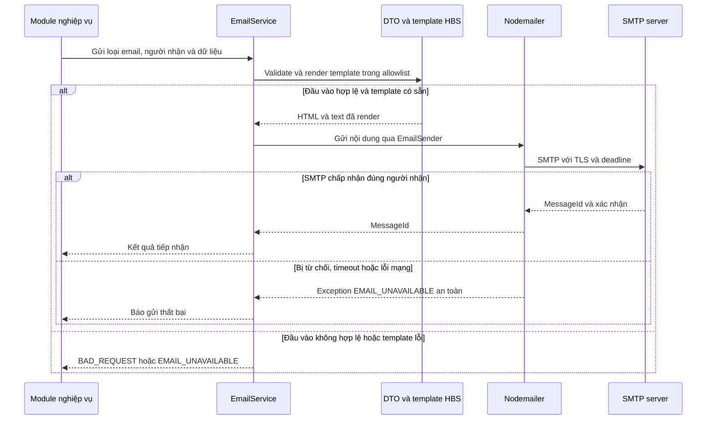

# Email infrastructure

## Hiện trạng và phạm vi đã duyệt

Đã triển khai ngày 2026-11-25 theo phê duyệt của người dùng: Nodemailer SMTP, ba template HBS và cấu hình env. `ses/` chỉ có `.gitkeep`; chưa có SES adapter/SDK. Không có endpoint gửi công khai, sinh/xác minh OTP, API auth hoặc scheduler nhắc học. Đọc [AGENTS backend](../../../AGENTS.md), [README backend](../../../README.md) và [tài liệu backend](../../../../docs/backend/README.md).

## Trách nhiệm

- `email.module.ts`: import SmtpEmailModule và export EmailService cho module nghiệp vụ.
- `email.service.ts`: nhận input, gọi DTO validate, render rồi gửi qua interface EmailSender.
- `dto/send-template-email.dto.ts`: validate một mailbox, template, payload và HTTPS study URL. Không nhận đường dẫn template tùy ý.
- `email-template.service.ts`: allowlist ba template, đọc HBS cạnh file source/compiled, render với strict và HTML escaping mặc định, tạo subject/text tĩnh theo loại.
- `interfaces/email.interface.ts`: EMAIL_SENDER DI token, EmailSender, các input và result.
- `nodemailer/`: adapter SMTP và lifecycle; xem [README adapter](nodemailer/README.md).
- `templates/`: send-code.hbs, study-reminder.hbs, verify-email-code.hbs. Template là asset copy qua Nest CLI sang dist cùng đường dẫn tương đối; dùng parser HTML khi format HBS để giữ DOCTYPE.

## Public contract

Module gọi import EmailModule rồi inject EmailService. Ba method trả `Promise<{ messageId: string }>`:

| Method | Input |
| --- | --- |
| sendCode | to, code, expiresInMinutes |
| sendVerifyEmailCode | to, code, expiresInMinutes |
| sendStudyReminder | to, name, lessonTitle, studyUrl |

- to: một email hợp lệ, tối đa 254 ký tự, không CR/LF hoặc danh sách người nhận.
- code: chuỗi đúng 6 chữ số, giữ số 0 đầu; expiresInMinutes: số nguyên 1–60. Caller/auth sở hữu TTL thật, sinh mã, chống replay và giới hạn gửi; email chỉ trình bày nội dung.
- name: 1–120, lessonTitle: 1–200 ký tự sau trim; studyUrl: HTTPS, tối đa 2048, không credentials/CR/LF. Không tải tài nguyên từ URL này.
- Payload từ chối field ngoài contract. Nội dung người dùng được escape qua HBS, không triple-stash.
- Cả HTML và text đều có nội dung cần thiết. Branding mẫu theo sender được yêu cầu: Đâu Nè!

Ví dụ sử dụng khi caller đã có nghiệp vụ hợp lệ (không phải endpoint gửi tự do):

```ts
await email.sendVerifyEmailCode({
  to: 'learner@example.com',
  code: '012345',
  expiresInMinutes: 5,
});
await email.sendStudyReminder({
  to: 'learner@example.com',
  name: 'An',
  lessonTitle: 'Hiragana cơ bản',
  studyUrl: 'https://example.com/learn',
});
```

## Cấu hình

Tất cả source đọc qua envConfig tại [config](../../config/README.md). EMAIL_ENABLED mặc định false; .env.local đã thêm cấu hình thật theo yêu cầu, file bị Git ignore. .env.example chỉ có dữ liệu mẫu và secret trống.

| Biến | Contract |
| --- | --- |
| EMAIL_ENABLED | true/false, mặc định false |
| SMTP_HOST | Hostname SMTP khi bật |
| SMTP_PORT | Số nguyên 1–65535, mặc định 465 |
| SMTP_SECURE | true/false, mặc định true; port 465 bắt buộc true |
| SMTP_USER, SMTP_PASS | Bắt buộc khi bật; không log hoặc trả ra ngoài |
| EMAIL_FROM | Một mailbox hoặc Tên hiển thị <email> |
| SMTP_TIMEOUT_MS | 1–120000 ms, mặc định 15000 |
| AUTH_EMAIL_VERIFICATION_KEY | Tùy chọn đến khi auth được tích hợp; khi có là 64 ký tự hex/32 byte; envConfig.auth.emailVerificationKey |

Khóa xác minh tách biệt JWT secret; mới chỉ được cấu hình và kiểm tra định dạng, chưa được dùng để mã hóa/phát hành token. SMTP không sử dụng khóa này.

## Luồng



## Lỗi và kiểm chứng

Input sai: BadRequestException/BAD_REQUEST. Tắt email, SMTP reject, timeout, không xác nhận người nhận, thiếu messageId hoặc template không đọc/render được: ServiceUnavailableException/EMAIL_UNAVAILABLE. Không log payload, người nhận, mã, raw cause hoặc credentials; chỉ trả messageId.

SMTP chấp nhận không bảo đảm thư vào inbox. Không retry tự động để tránh gửi trùng khi kết quả mạng chưa rõ. Transporter chỉ kết nối khi có yêu cầu gửi, không verify/gửi lúc startup; shutdown đóng transporter.

Dependency khóa: nodemailer 10.6.1 (có type tích hợp), handlebars 4.7.10; Node 24, Nest 12, TypeScript strict ESM. Không thêm @types/nodemailer hoặc AWS SES SDK.

Kiểm chứng: npm run typecheck, npm test, npm run lint, npm run format:check, npm run build đều pass. Test mới tại test/src/infrastructure/email và test/src/config/email.config.spec.ts: 41 ca; toàn backend 269 ca pass. Test mock SMTP/env và kiểm tra validation, escaping, lỗi không lộ dữ liệu, deadline, lifecycle và DI. Cả ba template build trùng source, render từ dist và soạn được với Nodemailer JSON transport không gửi mạng. Đã kiểm tra env local bị ignore, secret không xuất hiện trong source/docs/example và SES chỉ có .gitkeep. Chưa gửi email thật hoặc xác minh credentials thật.

npm audit hiện báo 5 cảnh báo moderate liên quan dependency toolchain Stryker (minimatch, typed-rest-client/qs), không nằm trong Nodemailer/Handlebars. Task này không nâng các dependency ngoài phạm vi. Thư mục provider vẫn là nodemailer; file bên trong dùng tên ngắn: sendmail.service.ts, email.module.ts, email.tokens.ts.
