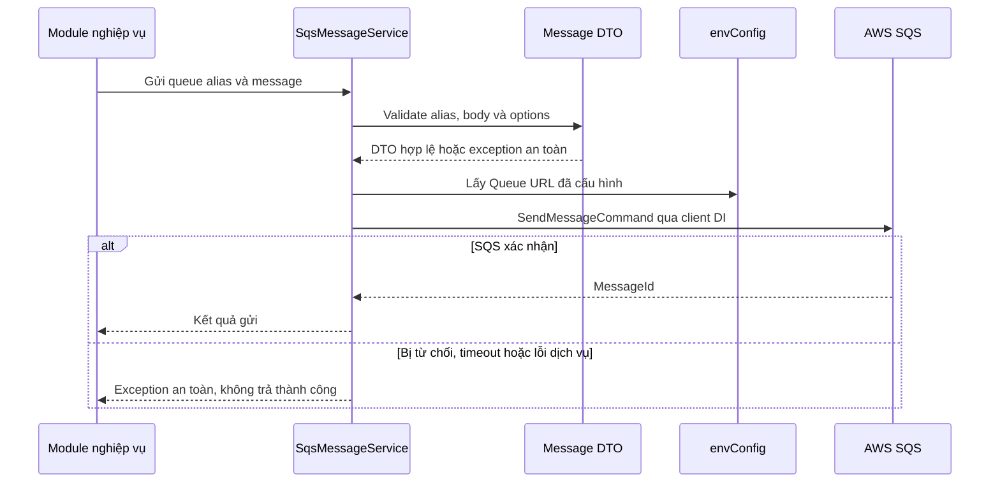

# SQS — gửi message tới queue đã cấu hình

## Trạng thái

Ngày 2026-11-24: đã có SqsModule và SqsMessageService, dùng AWS SDK qua DI; AppModule đã import SqsModule. Mặc định tắt SQS. Chưa xác minh kết nối/gửi message tới queue thật.

Đọc cùng [backend/AGENTS.md](../../../AGENTS.md) và [tài liệu backend](../../../../docs/backend/README.md) trước khi sửa. Hạ tầng này gửi message tới queue đã tồn tại; module nghiệp vụ gọi public service qua DI.

## File và public interface

```text
src/infrastructure/queue/
├── README.md
├── sqs.module.ts
├── sqs.tokens.ts
├── sqs-message.service.ts
├── sqs.types.ts
└── dto/
    ├── send-sqs-message.dto.ts
    └── sqs-message-options.dto.ts
```

- `SqsModule` tạo một SQSClient qua token DI, export `SqsMessageService`, đóng client khi shutdown.
- `sendMessage(queueName, messageBody, options?)` gửi text; `sendJsonMessage(queueName, payload, options?)` serialize JSON rồi dùng cùng luồng gửi, trả messageId khi SQS xác nhận.
- QueueName là alias trong env; không nhận Queue URL tùy ý từ request HTTP. Class tra alias, không tạo function riêng chỉ để đổi URL cho từng queue.
- Chỉ dùng SQS Standard. Options chỉ có delaySeconds 0–900; không nhận group/dedup option hoặc Queue URL FIFO.
- SendSqsMessageDto và SqsMessageOptionsDto giữ validation alias/body/options và JSON serialization; service chỉ resolve queue đã cấu hình rồi gửi message. Luồng refactor: caller → DTO validate → service resolve alias → AWS SendMessage → messageId hoặc lỗi an toàn. Không thêm dependency.

Module nghiệp vụ import SqsModule và inject SqsMessageService qua constructor. Ví dụ sau dùng alias giả đã được khai báo trong env:

```typescript
const result = await this.sqs.sendJsonMessage('example', {
  eventId: 'example-event-id',
  documentId: 'example-document-id',
});
// result.messageId là xác nhận từ SQS, không phải kết quả consumer xử lý.
```

## Cấu hình qua envConfig

| Biến | Ý nghĩa |
| --- | --- |
| `SQS_ENABLED` | Bật tích hợp, mặc định false |
| `SQS_REGION` | Region, fallback AWS_REGION |
| `SQS_QUEUE_URLS` | JSON object ánh xạ alias sang Queue URL |
| `SQS_TIMEOUT_MS` | Giới hạn thời gian gửi, giá trị dương |
| `AWS_ACCESS_KEY_ID`, `AWS_SECRET_ACCESS_KEY`, `AWS_SESSION_TOKEN` | Credentials chuẩn nếu dùng; ưu tiên credential provider chain/IAM role phù hợp |

Ví dụ giả trong `.env.example`; đặt cấu hình thật ở env không được Git theo dõi:

```dotenv
SQS_ENABLED=false
SQS_REGION=ap-southeast-1
SQS_TIMEOUT_MS=5000
SQS_QUEUE_URLS={"example":"https://sqs.ap-southeast-1.amazonaws.com/000000000000/example-queue"}
```

Chỉ lớp config đọc env và parse JSON, qua envConfig.queue. Khi bật phải có region, timeout nguyên dương và ít nhất một queue alias; các queue dùng cùng region đã cấu hình. URL HTTPS dạng accountId/queueName, không credentials/query/fragment/port tùy ý. Alias là chữ cái đầu, tiếp theo chữ/số/gạch ngang/gạch dưới, tối đa 64 ký tự. Config được validate trước khi dùng, lỗi không in giá trị env hoặc URL ra log. Queue URL giữ nguyên phân biệt hoa thường. Client dùng AWS credential chain; tạo client không kiểm tra IAM/quyền queue hoặc gửi message lúc startup.

## Luồng gửi



## Lỗi, bảo mật và kiểm chứng

- Tắt SQS/queue alias thiếu: từ chối gửi, không âm thầm bỏ message. Body phải hợp lệ theo SQS và giới hạn byte UTF-8; JSON không serialize được phải bị từ chối trước gọi AWS.
- Body text dài 1–1.048.576 byte UTF-8 và chỉ có ký tự SQS cho phép. sendJsonMessage dùng JSON.stringify, từ chối payload không serialize được; caller chịu trách nhiệm contract dữ liệu nghiệp vụ.
- DTO từ chối options lạ, null/sai kiểu, delaySeconds ngoài khoảng hoặc không nguyên. Queue config chỉ nhận URL Standard; các field đã bỏ không được âm thầm chấp nhận.
- SDK retry hữu hạn và timeout; lỗi mạng có thể xảy ra sau khi SQS nhận message, không khẳng định exactly-once. Caller cần event ID ổn định/policy dedup phù hợp khi use case yêu cầu.
- Config sai khi bật làm khởi tạo thất bại. Unknown alias/body/options sai trả BadRequestException với ErrorCode.BAD_REQUEST; tắt SQS, AWS reject/timeout hoặc thiếu MessageId trả ServiceUnavailableException với ErrorCode.QUEUE_UNAVAILABLE. Không log body, Queue URL, credentials hoặc raw lỗi AWS; xác nhận gửi không đồng nghĩa consumer đã xử lý.
- Đã cài `@aws-sdk/client-sqs@3.1176.0`, yêu cầu Node >=20. Không tự tạo queue, sửa IAM hoặc gửi message thật trong test mặc định.
- Test tại `test/src/infrastructure/queue/` và `test/src/config/queue.config.spec.ts`: resolve nhiều queue, text/JSON, config sai, disabled, unknown alias, body/options sai, SDK reject/timeout và shutdown. Mock AWS; chạy typecheck, test, lint, format check và build. Kết nối/gửi queue thật cần cấu hình và phạm vi riêng.

Tham khảo: [AWS SendMessage](https://docs.aws.amazon.com/AWSSimpleQueueService/latest/APIReference/API_SendMessage.html).
