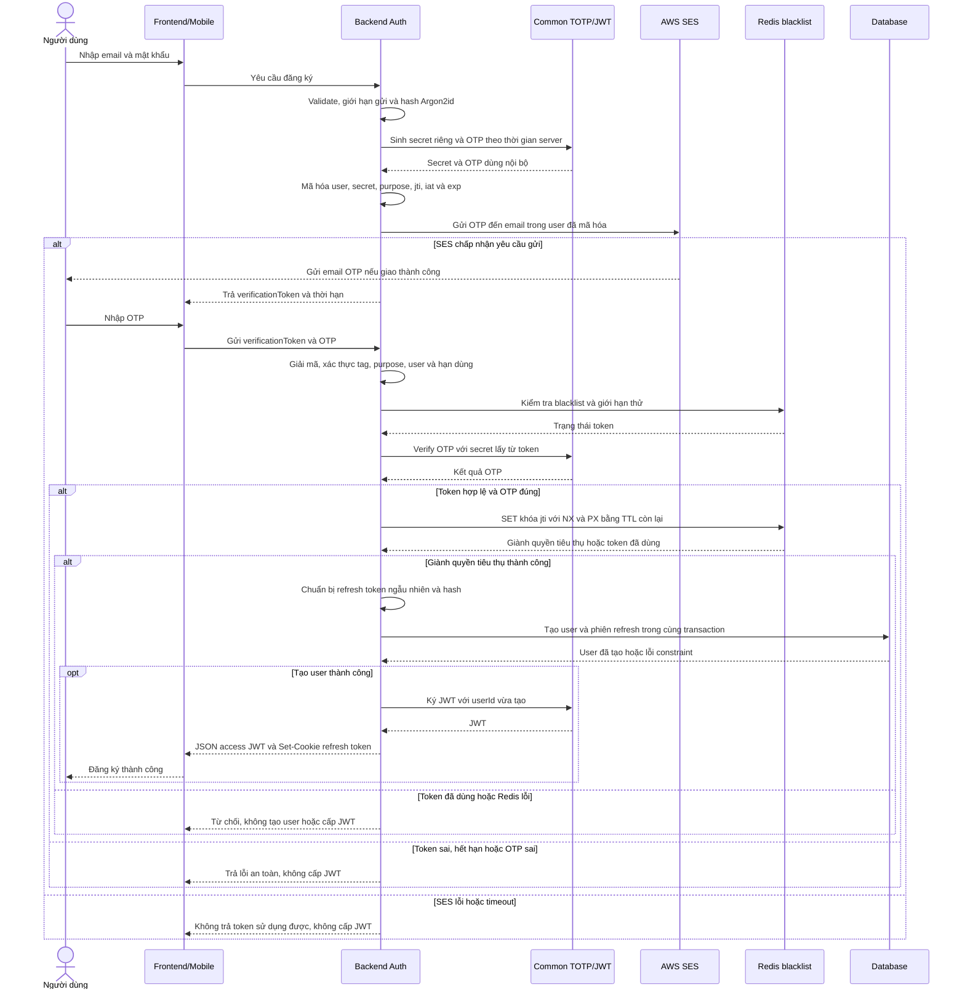
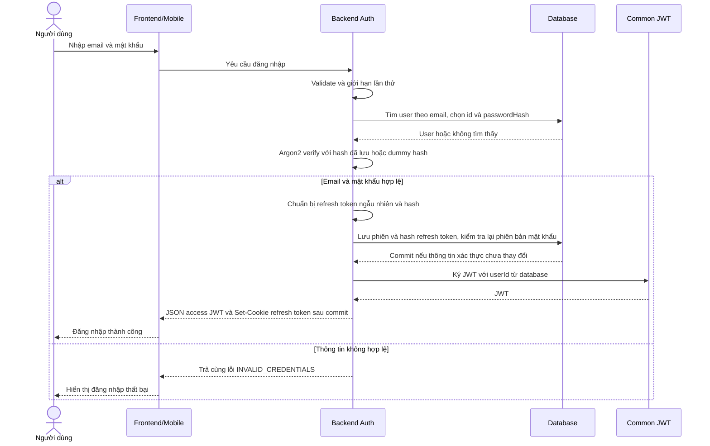
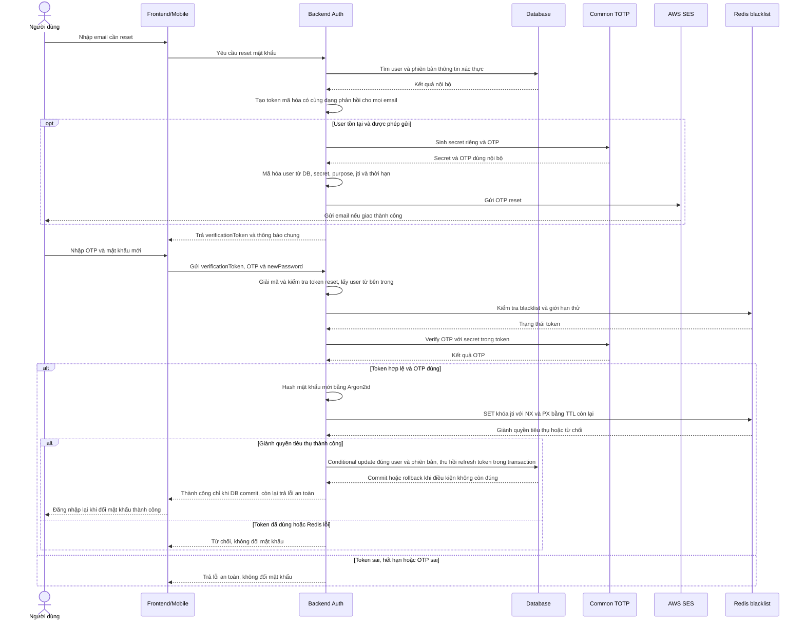
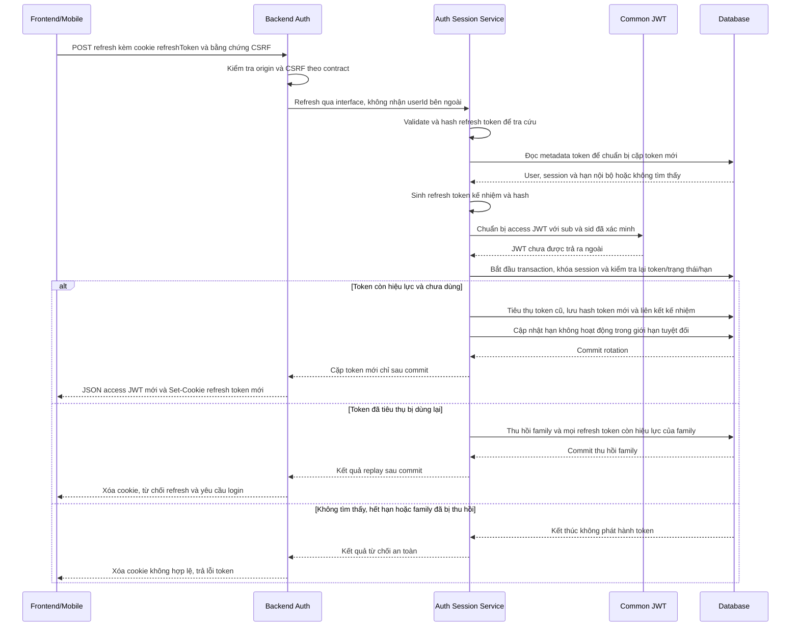
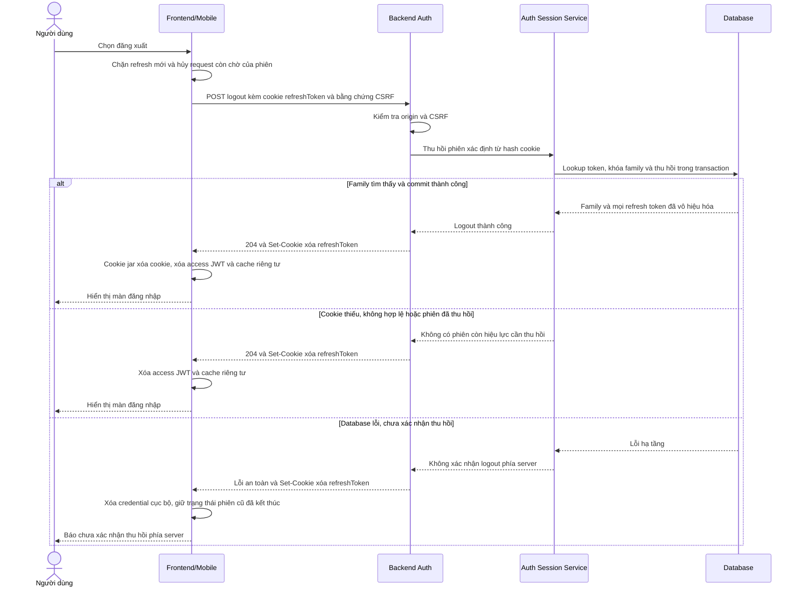

# Auth — đăng ký, đăng nhập, reset và refresh token rotation

## Trạng thái và cách đọc

Ngày 2026-11-24: đây là **thiết kế trước triển khai**. Module chỉ có README, chưa có code auth, Argon2, SES hoặc Redis tích hợp. Tài liệu không tự cho phép cài package, sửa code hay chạy migration.

AI phải đọc lại README này trước mỗi task auth, cùng [hướng dẫn backend](../../../AGENTS.md), [tài liệu backend](../../../../docs/backend/README.md) và [quy tắc AI chung](../../../../docs/ai-rules/README.md).

## Yêu cầu đã chốt

- Mật khẩu lưu dưới dạng Argon2id hash. Login dùng `verify(hash, password)`, không hash mới rồi so sánh chuỗi.
- TOTP gửi qua AWS SES dùng cho đăng ký và quên mật khẩu; không phải bước Authenticator thứ hai khi login.
- **Không lưu TOTP secret hoặc phiên OTP trong database.** Backend mã hóa secret cùng thông tin user thành `verificationToken`, gửi frontend; frontend giữ token như chuỗi opaque rồi gửi lại cùng OTP.
- Backend giải mã có xác thực để lấy secret và danh tính bên trong token. Không chọn user từ `userId`, email, secret hoặc payload định danh gửi riêng ở bước verify.
- Khi OTP đúng, đánh dấu token đã dùng trong Redis với TTL bằng thời gian hiệu lực còn lại; chỉ request giành quyền tiêu thụ token atomic thành công mới được tiếp tục ghi database hoặc cấp JWT.
- Tái sử dụng TOTP/JWT trong `common/verifications`. Xác minh đăng ký thành công tạo user rồi cấp JWT; login đúng cấp JWT. Reset xong yêu cầu đăng nhập lại.
- Khi đăng ký được xác minh hoặc login thành công, cấp cặp access JWT và refresh token. Mỗi lần refresh hợp lệ thay refresh token cũ bằng token mới; nghiệp vụ phiên thuộc auth, không đưa vào common JWT.
- Access JWT giữ trong bộ nhớ frontend và gửi qua `Authorization: Bearer <accessToken>`. Refresh token chỉ truyền bằng cookie `HttpOnly`; login/verify/refresh không trả refresh token trong JSON.
- Logout thu hồi family ở backend, xóa cookie refresh token và xóa access JWT/cache riêng tư ở frontend.

## 1. Hiện trạng

- `users` đã có `id`, `email`, `passwordHash`, timestamp và unique index trên `lower(email)`; `refresh_tokens` hỗ trợ thu hồi refresh token nhưng chưa có luồng auth sử dụng.
- `TotpGenerateService.generateCode(secret)` sinh mã 6 chữ số, SHA-1, chu kỳ 30 giây.
- `TotpVerifyService.verifyCode(otp, secret)` dùng thời gian server, chu kỳ 30 giây, tolerance 30 giây và trả boolean.
- `JwtSignService.signToken({ sub })` ký theo `envConfig.jwt`.
- Schema `refresh_tokens` hiện chỉ có `id`, `userId`, `tokenHash`, `expiresAt`, `revokedAt`, `createdAt`; chưa có session/family, liên kết token kế nhiệm hoặc trạng thái rotation. Common JWT hiện chỉ có contract `sub`, chưa hỗ trợ session claim.
- Chưa có sinh secret, mã hóa verification token, Redis blacklist, giới hạn thử hoặc gửi email. `common/verifications` và database chưa có README riêng; khi sửa cần khảo sát code và hướng dẫn thư mục cha.
- Kiểm tra code ngày 2026-11-24: chưa có `res.cookie()`/`res.clearCookie()`, cookie parser hoặc cấu hình CORS credentials trong bootstrap; `src/module/auth/` vẫn chỉ có README. Quy tắc cookie bên dưới là hướng dẫn cần triển khai, không phải tính năng đã chạy.

## 2. Tổ chức module và contract API

```text
src/module/auth/
├── README.md
├── auth.module.ts
├── auth.controller.ts
├── auth.service.ts
├── auth-session.service.ts
├── auth.repository.ts
├── dto/
│   ├── refresh-token.dto.ts
│   └── token-response.dto.ts
└── interfaces/
    ├── auth-service.interface.ts
    ├── auth-session-service.interface.ts
    └── auth-repository.interface.ts
```

Controller nhận DTO và gọi interface; session service quyết định policy; một repository giữ transaction. Chỉ tách `auth-session.repository.ts` khi truy vấn phiên đủ phức tạp để có trách nhiệm riêng. `common/verifications` chỉ ký/verify JWT, không quản lý family hoặc tự đọc database. Redis OTP blacklist độc lập với rotation refresh token trong PostgreSQL.

- Giữ `src/module/auth/`: controller, service, repository, `dto/`, `interfaces/` và README; chỉ tạo file có nhu cầu thực tế.
- Auth service sở hữu phát hành/giải mã token, chọn user từ token, policy thử/gửi lại và tiêu thụ qua interface Redis. Không tự ghép SQL.
- `auth-session.service.ts` sở hữu cấp cặp token, rotation, logout và phát hiện refresh token dùng lại; `auth.service.ts` gọi interface này sau khi xác thực user. Giữ trong cùng module auth, không tạo module JWT/session riêng khi chưa có nhu cầu.
- Repository truy vấn user, tạo user, quản lý phiên refresh và cập nhật mật khẩu/thu hồi phiên. Không có bảng phiên OTP, không lưu secret. Hash mật khẩu và gọi SES nằm ngoài transaction DB.
- Common sở hữu TOTP/JWT và tiện ích mật mã trung lập nếu cần tái sử dụng. Không sao chép thuật toán TOTP vào auth.
- Adapter email dự kiến ở `src/infrastructure/email/`; Redis ở `src/infrastructure/redis/`, export interface rõ ràng. Các adapter không chứa nghiệp vụ auth.

| Method và route đề xuất | Input | Output dự kiến |
| --- | --- | --- |
| `POST /auth/register` | email, password | verificationToken, thời hạn |
| `POST /auth/register/verify` | verificationToken, otp | JSON access JWT, cookie refresh token sau khi tạo user/phiên thành công |
| `POST /auth/login` | email, password | JSON access JWT, cookie refresh token sau khi xác thực/lưu phiên thành công |
| `POST /auth/refresh` | Cookie refresh token, kiểm tra CSRF | JSON access JWT mới, thay cookie refresh token, token cũ bị tiêu thụ |
| `POST /auth/logout` | Cookie refresh token, kiểm tra CSRF | Thu hồi family, xóa cookie, `204` không body |
| `POST /auth/password-reset/request` | email | verificationToken, thời hạn và thông báo chung |
| `POST /auth/password-reset/confirm` | verificationToken, otp, newPassword | Xác nhận đổi mật khẩu, đăng nhập lại |

`newPassword` là dữ liệu thay đổi cần thiết, không phải danh tính để chọn user; danh tính reset chỉ lấy từ token giải mã. DTO verify không nhận `userId`, email, secret, exp hoặc purpose rời để ghi đè dữ liệu token. Field thừa bị từ chối. Các endpoint chưa tồn tại; prefix, HTTP status và OpenAPI sẽ chốt theo code khi triển khai.

Lỗi theo `{ code, message, details, requestId }`, dùng `ErrorCode`; Swagger tiếng Anh ngắn gọn. Nếu dùng `@Public()`, phải có Guard hỗ trợ. Không log request body, OTP, token mã hóa, secret, password hoặc passwordHash.

## 3. Lưu và truyền token

| Thành phần | Nơi lưu | Cách gửi |
| --- | --- | --- |
| Access JWT | Bộ nhớ frontend, xóa khi logout; không localStorage/sessionStorage | Header `Authorization: Bearer <accessToken>` khi gọi API được bảo vệ |
| Refresh token | Cookie `refreshToken` do backend đặt qua `Set-Cookie`; frontend JavaScript không đọc | Client tự gửi cookie tới refresh/logout; không gửi trong body, query hoặc Authorization |
| Hash refresh token | PostgreSQL, gắn với session/family | Chỉ dùng nội bộ để tra cứu/rotation; không trả client |
| verificationToken OTP | Bộ nhớ tạm trong luồng đăng ký/reset | Body cùng OTP; không dùng làm access/refresh token |

`Authorization` là nơi truyền access JWT, không phải kho lưu token. Response login, verify đăng ký và refresh trả `accessToken`, `tokenType: 'Bearer'`, `expiresIn` trong JSON; refresh token chỉ nằm trong `Set-Cookie`. Response chứa credential đặt `Cache-Control: no-store`.

### Cookie, credentials và CSRF

- Cookie refresh dùng `HttpOnly`, `Secure`, `SameSite=Lax` cho triển khai same-site; mặc định host-only, không khai báo `Domain` dùng chung toàn bộ subdomain.
- `Path` giới hạn tới nhóm route auth thực tế, ví dụ `/auth` hoặc `/api/v1/auth` khi prefix đã được triển khai. Dùng cùng cấu hình Path/Domain khi cấp, rotation và xóa cookie; không lấy path ví dụ làm bằng chứng prefix đã tồn tại.
- `Max-Age`/`Expires` theo thời gian refresh token còn hiệu lực và không vượt hạn tuyệt đối của family. Mỗi rotation ghi đè cookie cùng tên/phạm vi bằng token mới.
- Browser gọi login/verify/refresh/logout với credentials phù hợp, ví dụ `credentials: 'include'` khi khác origin. Backend CORS cho phép credentials với origin cụ thể, không dùng wildcard origin.
- Các endpoint thay đổi cookie/phiên phải kiểm tra origin được phép và cơ chế CSRF đã xác minh. Chốt token/header CSRF và cách cấp trước khi code; không coi `HttpOnly`, CORS hoặc `SameSite` đơn lẻ là đủ cho mọi deployment.
- Nếu frontend và API thực sự cross-site, cần duyệt cấu hình `SameSite=None; Secure`, CSRF và khả năng browser chặn third-party cookie; không tự đổi vì khác origin đồng nghĩa khác site.
- App native phải có cookie jar hỗ trợ nhận, gửi, thay và xóa cookie đúng trên từng nền tảng. Khảo sát và kiểm thử trong task mobile; không tự chuyển refresh token sang body/secure storage để tạo contract song song, không suy ra semantics browser của `HttpOnly` áp dụng giống native.
- Frontend refresh một lần khi khởi động lại để lấy access JWT nếu cookie còn hợp lệ. Refresh thất bại do token hết hạn/thu hồi thì xóa access JWT/cache và yêu cầu login; không lặp refresh vô hạn.

### Cách thêm cookie trong NestJS/Express

Thực hiện trong task code được duyệt, theo thứ tự:

1. Thêm cấu hình cookie/CORS vào `src/config/env.config.ts` và `.env.example`: tên cookie, Path theo prefix thực tế, Secure, SameSite và danh sách origin. Validate khi khởi động; không nhận các giá trị này từ request client.
2. Khi cần parse cookie, đề xuất và duyệt `cookie-parser` cùng kiểu TypeScript tương ứng, rồi đăng ký `app.use(cookieParser())` trong bootstrap trước route. **Đặt cookie bằng `res.cookie()` không cần cookie-parser**; middleware này dùng để đọc cookie từ request.
3. Cấu hình CORS `credentials: true` và allowlist origin qua `envConfig`. Triển khai kiểm tra origin/CSRF trước refresh/logout; middleware parse cookie không tự xác thực token hoặc chống CSRF.
4. Controller dùng `@Res({ passthrough: true }) res: Response` để đặt header/cookie rồi vẫn return DTO cho Nest serialize. Service trả kết quả nghiệp vụ, không nhận Express response. Logic cookie có thể đặt trong `auth-cookie.ts` cạnh controller để dùng chung, không đặt trong repository.
5. Login, verify đăng ký và refresh: chỉ đặt cookie sau khi lưu/rotation phiên thành công. Đọc `request.cookies.refreshToken` ở refresh/logout sau khi middleware được đăng ký; coi giá trị này là `unknown`, validate kiểu/độ dài trước khi gọi service. Không fallback sang body hoặc Authorization.
6. Logout/reset và lỗi refresh xác định token không còn hợp lệ: xóa cookie theo cùng scope. Lỗi DB/network tạm thời khi refresh không tự coi token đã hết hiệu lực; xử lý theo policy lỗi, không vô tình xóa phiên còn dùng được.

Ví dụ transport sau đây **chỉ là mẫu**, chưa phải file đã triển khai. `scope` được tạo từ cấu hình server đã validate, có `httpOnly: true`, `secure: true`, `sameSite` và `path` phù hợp; không chứa `maxAge`/`expires` cố định. Ví dụ dùng Express `maxAge` theo **millisecond**, trong khi header `Max-Age` dùng giây.

```typescript
import type { CookieOptions, Response } from 'express';

type CookieScope = Omit<CookieOptions, 'maxAge' | 'expires'>;

export function setRefreshCookie(
  res: Response,
  name: string,
  token: string,
  expiresAt: Date,
  scope: CookieScope,
): void {
  const remainingMs = expiresAt.getTime() - Date.now();
  if (!Number.isFinite(remainingMs) || remainingMs <= 0) {
    throw new RangeError('Refresh token has expired');
  }
  res.cookie(name, token, { ...scope, maxAge: remainingMs });
}

export function clearRefreshCookie(
  res: Response,
  name: string,
  scope: CookieScope,
): void {
  res.clearCookie(name, scope);
}
```

`res.clearCookie()` tạo cookie hết hạn; không truyền lại `maxAge`/`expires` còn hạn khi clear. Scope phải giữ đúng tên/Path/Domain đã cấp. Trong Express, mẫu clear này dùng expiry quá khứ thay cho việc tự viết header `Max-Age=0`; cả hai đều nhằm xóa cùng cookie.

Ví dụ phần thân handler login/refresh, sau khi service đã commit thành công và các dependency/config tương ứng được triển khai:

```typescript
setRefreshCookie(
  res,
  cookieName,
  result.refreshToken,
  result.refreshExpiresAt,
  cookieScope,
);
res.setHeader('Cache-Control', 'no-store');
return {
  accessToken: result.accessToken,
  tokenType: 'Bearer',
  expiresIn: result.expiresIn,
};
```

Không `return result` nếu object nội bộ chứa refreshToken. Logout gọi `clearRefreshCookie()` sau khi xử lý thu hồi phiên, đặt `@HttpCode(204)` và không return body; nhánh lỗi hạ tầng cũng cần xử lý clear theo phần logout, không giả vờ thu hồi thành công.

Frontend gọi login/verify/refresh/logout với `credentials: 'include'` khi cần credentials cross-origin. Browser nhận `Set-Cookie` và quản lý cookie, JavaScript không đọc header này hoặc giá trị HttpOnly. Những API khác nhận access JWT trong `Authorization`. Ví dụ này chưa triển khai CSRF: trước khi chạy cần hoàn thiện cơ chế cấp/kiểm tra CSRF theo deployment đã duyệt.

Kiểm thử tối thiểu: dùng HTTP agent giữ cookie qua login → refresh → logout; kiểm tra `Set-Cookie`, scope/TTL, JSON không có refreshToken, cookie mới thay token cũ và logout khiến token cũ không refresh được. Test browser/native riêng để xác nhận cookie thực sự được lưu/gửi/xóa; mock HTTP agent không chứng minh đầy đủ behavior của browser.

## 4. Token xác minh OTP

Hash một chiều không giải mã được. Secret phải được **mã hóa có xác thực**, dự kiến AES-256-GCM với nonce mới cho mỗi token. Base64 hoặc JWT chỉ ký không bảo mật nội dung secret. Frontend không có khóa giải mã.

| Dữ liệu bên trong token | Ý nghĩa |
| --- | --- |
| `jti` | ID ngẫu nhiên duy nhất do server tạo, dùng làm khóa chống dùng lại |
| `purpose` | `register` hoặc `password-reset`, kiểm tra đúng endpoint |
| `user` | Đăng ký: email đã chuẩn hóa và passwordHash do server tạo; reset: userId, email và phiên bản thông tin xác thực do server đọc từ database |
| `secret` | TOTP secret ngẫu nhiên riêng cho token, không công khai |
| `iat`, `exp` | Thời điểm phát hành/hết hạn do server xác định, thống nhất đơn vị giây |
| `version` | Phiên bản contract token để validate sau giải mã |

Thông tin user, secret, mục đích và thời hạn phải nằm trong cùng phần được mã hóa và xác thực. Envelope có thể có key ID để chọn khóa rotation, nonce, ciphertext và authentication tag; giới hạn kích thước và kiểm tra chặt định dạng, phiên bản, tag, thời gian và kiểu dữ liệu. Không sử dụng nội dung đã giải mã trước khi kiểm tra tag thành công.

Với đăng ký, passwordHash nằm trong token được mã hóa để khi verify không phải nhận lại email/mật khẩu ngoài token và không cần lưu phiên tạm vào database. Không nhét mật khẩu thô vào token. Với reset, đối chiếu phiên bản thông tin xác thực với database để token cũ không thay mật khẩu sau một lần đổi/reset khác.

## 5. Đăng ký và xác minh email



Không ghi secret vào database ở bất kỳ bước nào. SES chấp nhận gửi không bảo đảm email đến hộp thư. Sau khi token đã bị tiêu thụ, nếu tạo user hoặc ký JWT thất bại thì giữ blacklist; người dùng yêu cầu token mới hoặc đăng nhập nếu user đã tạo. Lỗi unique email xử lý theo contract, không cấp JWT từ một lần insert thất bại.

## 6. Đăng nhập



Không trim/đổi nội dung mật khẩu; không trả hash hoặc secret công khai. Dummy hash chỉ giảm khác biệt xử lý khi không có tài khoản, không cho phép đăng nhập.

## 7. Quên và đặt lại mật khẩu



Email không tồn tại vẫn nhận phản hồi cùng schema và token opaque có kích thước/thời hạn tương đương; token giả không được đủ điều kiện reset tài khoản nào. Nội dung phản hồi, lỗi SES, giới hạn thử và khác biệt thời gian không được trở thành kênh dò user. Chi tiết cơ chế này cần được chốt và kiểm thử khi triển khai.

## 8. Redis blacklist và chống verify lần hai

1. Sau giải mã, từ chối token hết hạn, sai mục đích, sai user hoặc có `jti` trong blacklist. OTP sai không được đánh dấu thành công; tăng bộ đếm lần thử có TTL theo chính sách.
2. Khi OTP đúng và dữ liệu hợp lệ, tính lại `ttlMs = exp * 1000 - serverNowMs`. Nếu `ttlMs <= 0`, từ chối ngay. Tính lại sau các thao tác tốn thời gian như Argon2.
3. Đặt khóa `auth:otp:used:<jti>` bằng **một lệnh atomic** `SET key 1 NX PX ttlMs`. Chỉ kết quả thành công mới cho phép tiếp tục. Không dùng `GET` rồi `SET` làm cơ chế tiêu thụ vì hai request có thể cùng vượt qua.
4. Đặt blacklist sau khi OTP đã verify đúng nhưng **trước** thao tác thay đổi user/cấp JWT. Nếu đợi đến sau DB/JWT mới thêm blacklist thì request đồng thời có thể cùng thực hiện nghiệp vụ.
5. Redis chỉ lưu ID/token fingerprint đã dùng và metadata chống lạm dụng cần thiết, không lưu secret hoặc token thô. TTL theo hạn của token chứa secret, không theo access JWT và không tự kéo dài bởi tolerance TOTP.
6. Redis lỗi hoặc mất trạng thái chống dùng lại thì từ chối verify, không fallback sang bộ nhớ process. Cần chốt persistence, replication và chính sách tránh eviction trước production; mất blacklist có thể làm token còn hạn dùng lại được.
7. Redis và PostgreSQL không có transaction chung. Nếu đánh dấu thành công nhưng DB lỗi, giữ blacklist và yêu cầu phát hành token mới; không xóa khóa để thử lại một cách tự động. Không tuyên bố hai hệ thống có tính atomic chung.

Mỗi token dùng secret và jti mới. Khi gửi lại, phải blacklist token cũ bằng jti đã xác thực hoặc lưu phiên bản phát hành mới nhất theo user/mục đích trong Redis, không lưu secret. Cần chốt lựa chọn khi triển khai; blacklist token đã verify tự nó không vô hiệu hóa những token khác chưa dùng.

## 9. JWT và refresh token rotation

Đây là rotation refresh token, không phải xoay khóa ký JWT. Access token là JWT ngắn hạn; refresh token là chuỗi opaque sinh ngẫu nhiên mật mã, tối thiểu 32 byte entropy. Database chỉ lưu SHA-256 hash của refresh token để tra cứu; Argon2id dành cho mật khẩu. Không lưu token thô, không dùng access JWT hoặc verificationToken OTP để refresh.

### Dữ liệu phiên cần bổ sung trước khi triển khai

- Mỗi lần login hoặc đăng ký thành công tạo một session/family riêng; refresh kế tiếp giữ nguyên session ID. Không coi mọi thiết bị của một user là cùng family.
- Đề xuất `auth_sessions`: ID, userId, ngày tạo, hạn tuyệt đối, hạn không hoạt động và trạng thái thu hồi. Đây là hàng ổn định để khóa khi rotation, logout hoặc reset; chưa có trong schema.
- Bổ sung `sessionId`, `consumedAt`, `replacedByTokenId` cho `refresh_tokens`, hoặc mô hình tương đương được duyệt. Dùng FK/index/constraint để token mới thuộc đúng user/family và token cũ chỉ có một kế nhiệm.
- Giữ hash và quan hệ token đã dùng để phát hiện replay đến khi cả family hết hiệu lực; không xóa ngay token cũ sau rotation. Cleanup có giới hạn, không quét/xóa toàn bảng trong request.
- Access JWT dự kiến thêm `sid` lấy từ phiên do server tạo; `sub` lấy từ user đã xác thực. Algorithm, issuer, audience và expiry phải được verify. Cần mở rộng DTO/sign/verify và test common hiện có trước khi dùng `sid`; không coi đã được hỗ trợ.
- Hạn access JWT ngắn, refresh có hạn không hoạt động và hạn tuyệt đối của family; rotation không được kéo dài quá hạn tuyệt đối. Chốt giá trị qua `envConfig`, chưa cố định TTL trong tài liệu này.

### Sơ đồ refresh và phát hiện replay



Tra cứu metadata và chuẩn bị JWT bên ngoài transaction chỉ là bước chuẩn bị, không phải quyết định cho phép refresh. Nếu không tìm thấy token hoặc token rõ ràng không hợp lệ, dừng sớm; không tạo phiên/token cho user do client chỉ định. Trong transaction phải kiểm tra lại mọi điều kiện; JWT chuẩn bị sẵn không được trả nếu rotation thất bại.

### Atomic, đồng thời và token bị dùng lại

- Repository khóa hàng session ổn định rồi đọc/khóa token và kiểm tra lại điều kiện; rotation, logout và reset phải dùng cùng quy ước thứ tự khóa. Khi reset nhiều phiên, khóa theo thứ tự ID nhất quán; phối hợp khóa user/credential version với login để reset không bỏ sót phiên vừa tạo.
- Tiêu thụ token cũ và insert token mới trong một transaction; lỗi insert phải rollback cả việc tiêu thụ. Không chỉ SELECT kiểm tra rồi UPDATE vô điều kiện ở hai bước rời.
- Khi phát hiện token cũ đã dùng, thu hồi toàn family, gồm token kế nhiệm đang hoạt động. Chỉ thu hồi family tương ứng; reset mật khẩu thu hồi tất cả family của user.
- Phải commit việc thu hồi do replay trước khi ném HTTP exception. Không ném exception ngay trong transaction khiến thao tác thu hồi bị rollback.
- Với hai request dùng cùng refresh token, chỉ một request được rotation. Theo policy nghiêm ngặt này, request còn lại bị coi là replay và thu hồi family, nên token mới của request thắng cũng không dùng refresh tiếp được. Không tuyên bố request thắng có phiên còn hiệu lực sau khi replay được xử lý.
- Client cần single-flight refresh cho mỗi phiên và phối hợp giữa tab/process khi có. Không tự retry refresh token cũ sau timeout; server có thể đã commit nhưng response bị mất. Mặc định đăng nhập lại, không có grace period hoặc cấp lại token cũ. Nếu cần retry idempotent, phải thiết kế và duyệt riêng.
- Không dùng Redis OTP blacklist làm nguồn dữ liệu quyết định rotation; PostgreSQL sở hữu trạng thái phiên. Không log token thô, hash token hay nội dung credential.

### Reset và access JWT còn hạn

- Reset mật khẩu thay passwordHash/credential version và thu hồi tất cả family trong cùng transaction DB. Login phải kiểm tra lại phiên bản mật khẩu khi lưu phiên để không tạo phiên bằng mật khẩu cũ sau reset.
- Thu hồi refresh token không tự vô hiệu hóa access JWT còn hạn. Mặc định thiết kế access JWT được chấp nhận đến `exp`; `sid` giúp liên kết phiên nhưng không tự thực hiện revocation. Nếu cần logout/reset có hiệu lực ngay trên access token, phải bổ sung Guard kiểm tra trạng thái phiên/credential version hoặc cơ chế revoke tương ứng trong một phạm vi được duyệt.
- Reset thành công cũng gửi header xóa cookie refresh hiện tại; những thiết bị khác có thể còn giữ cookie nhưng các family đã bị thu hồi nên refresh bị từ chối. Frontend xóa access JWT và cache riêng tư rồi về login.

## 10. Logout và xóa refresh token

`POST /auth/logout` không yêu cầu access JWT còn hạn; cookie refresh xác định family cần thu hồi. Kiểm tra origin/CSRF vẫn bắt buộc theo contract. Không nhận userId bên ngoài để chọn phiên.



- Sau CSRF/origin hợp lệ, backend xóa cookie bằng `Set-Cookie` cùng tên, Path, Domain đã cấp, giá trị rỗng và `Max-Age=0` hoặc `Expires` trong quá khứ; với Express dùng `res.clearCookie()` như ví dụ ở phần cookie. Giữ chính sách `HttpOnly`, `Secure`, `SameSite` đồng bộ. Frontend không dùng `document.cookie` để xóa cookie HttpOnly.
- Backend vô hiệu hóa toàn family, gồm token kế nhiệm; token cũ còn lookup được cũng phải dẫn đến family đó. Không chỉ xóa cookie rồi coi phiên server đã bị thu hồi.
- Refresh token thô bị xóa khỏi cookie và không còn token hiệu lực ở backend. Hash/quan hệ token đã dùng có thể giữ đến hết thời hạn family để nhận diện replay; không bắt buộc DELETE vật lý toàn bộ lịch sử trong logout.
- Logout lặp lại hoặc cookie thiếu/không hợp lệ trả `204` không body, không tiết lộ phiên có tồn tại. Lỗi DB thật phải trả lỗi hạ tầng an toàn, không giả `204` xác nhận thu hồi. Nếu request bị chặn origin/CSRF thì không thực hiện logout.
- Frontend xóa access JWT, user state, query cache riêng tư, draft gắn tài khoản khi cần và thông báo các tab liên quan. Dùng session generation để response login/refresh đến muộn không khôi phục state sau logout.
- Logout và refresh khóa cùng family. Token/cookie mới có thể đến muộn do response đang bay; family đã revoke vẫn khiến token đó vô dụng. Frontend không nhận lại access JWT từ response của thế hệ phiên cũ. Kiểm thử race trên browser/cookie jar thực tế.
- Mặc định logout chỉ phiên hiện tại. Logout mọi thiết bị cần endpoint/use case riêng được duyệt; reset mật khẩu thu hồi mọi phiên theo policy đã mô tả.

## 11. Lỗi trả về người gọi API

Đây là **contract dự kiến của auth**, chưa phải các endpoint đã triển khai. HTTP status và `code` dùng để xử lý bằng chương trình; frontend map `code` sang thông báo tiếng Việt, không so sánh chuỗi `message`.

### Cấu trúc chung

```json
{
  "code": "INVALID_CREDENTIALS",
  "message": "Invalid email or password",
  "details": [],
  "requestId": "00000000-0000-4000-8000-000000000001"
}
```

- Body chỉ có `code`, `message` dạng chuỗi, `details` và `requestId`; status ở HTTP response. `details` là `string[]` theo exception filter hiện tại, chỉ chứa lỗi validation an toàn, không có input thật, password, token hoặc dữ liệu nội bộ.
- `message` trong bảng dưới là thông điệp API tiếng Anh; frontend hiển thị bản dịch theo mã lỗi. Request ID dùng để hỗ trợ tra cứu, không phải thông tin xác thực.
- Global filter hiện giữ mã lỗi được khai báo trong `ErrorCode`; mã chưa có sẽ bị đổi thành mã fallback theo status. Mã đánh dấu **mới** bên dưới phải được thêm vào enum và test trong task code trước khi dùng, không hardcode chuỗi ở service.
- Với mọi lỗi `5xx`, filter hiện thay message thành HTTP reason phrase và `details: []`. Bảng dùng đúng hành vi này; không yêu cầu trả nguyên lỗi SES/Redis/DB hoặc message nội bộ.

### Danh mục lỗi

| HTTP | `code` | Khi nào trả | `message` API dự kiến | Frontend hiển thị/xử lý |
| --- | --- | --- | --- | --- |
| 400 | `BAD_REQUEST` | JSON/body/cookie sai định dạng, thiếu field, field thừa hoặc mật khẩu không đạt contract | `Bad Request` | Kiểm tra dữ liệu nhập; lỗi field an toàn nằm trong `details` |
| 401 | `INVALID_CREDENTIALS` | Login sai email hoặc mật khẩu; cùng response cho cả hai | `Invalid email or password` | Email hoặc mật khẩu không đúng; không tự refresh từ lỗi login |
| 401 | `INVALID_TOKEN` | Token xác minh bị sửa, giải mã/tag thất bại, sai purpose/version/user; refresh cookie thiếu, hỏng hoặc không tìm thấy; access JWT không hợp lệ | `Invalid token` | Bắt đầu lại luồng xác minh hoặc đăng nhập tùy endpoint; không chỉ ra field mật mã sai |
| 410 | `TOKEN_EXPIRED` | verificationToken đăng ký/reset hết hạn | `Verification has expired` | Mã xác minh đã hết hạn, yêu cầu gửi lại; không gọi refresh JWT |
| 400 | `INVALID_OTP` **mới** | OTP đúng định dạng nhưng common verify không khớp; token vẫn hợp lệ | `Invalid verification code` | Mã xác minh không đúng; cho nhập lại trong giới hạn |
| 409 | `VERIFICATION_TOKEN_USED` **mới** | Token xác minh có trong blacklist hoặc thua lệnh consume Redis atomic | `Verification has already been used` | Phiên xác minh đã dùng; không tự gửi lại cùng token |
| 429 | `OTP_ATTEMPTS_EXCEEDED` **mới** | Vượt giới hạn lần thử OTP của phiên | `Too many verification attempts` | Dừng thử phiên đó; chỉ yêu cầu phiên mới theo cooldown |
| 429 | `TOO_MANY_REQUESTS` | Vượt rate limit login, gửi OTP, gửi lại, refresh hoặc reset | `Too many requests` | Chờ thời gian `Retry-After` nếu có; không retry vòng lặp |
| 409 | `EMAIL_ALREADY_EXISTS` | Tạo user bị unique conflict sau khi người gọi đã chứng minh quyền kiểm soát email qua OTP | `Email is already registered` | Email đã đăng ký; chuyển login/quên mật khẩu |
| 401 | `TOKEN_EXPIRED` | Access JWT hoặc refresh token/session hết hạn | `Token expired` | Access hết hạn: thử refresh single-flight; refresh hết hạn: xóa state và login |
| 401 | `REFRESH_TOKEN_REUSED` **mới** | Refresh token đã tiêu thụ bị gửi lại; phải commit thu hồi family trước trả lỗi | `Session is no longer valid` | Xóa state, yêu cầu login; cookie refresh bị xóa, không retry token cũ |
| 401 | `INVALID_TOKEN` | Family bị logout/reset/revoke hoặc credential version không còn hợp lệ | `Invalid token` | Refresh/reset bị từ chối; bắt đầu lại đúng luồng, không tiết lộ user/phiên tồn tại |
| 403 | `FORBIDDEN` | Origin/CSRF không hợp lệ ở endpoint cần kiểm tra | `Request is not allowed` | Từ chối thao tác; không tự refresh JWT hoặc lặp lại logout |
| 503 | `AUTH_PROVIDER_UNAVAILABLE` | SES không chấp nhận gửi hoặc timeout ở luồng được phép công khai lỗi gửi | `Service Unavailable` | Chưa gửi được mã; thử lại sau theo cooldown |
| 503 | `SERVICE_UNAVAILABLE` | Redis chống replay/giới hạn thử không khả dụng hoặc chưa đảm bảo trạng thái nhất quán | `Service Unavailable` | Tạm thời không xác minh được; không bypass Redis |
| 503 | `DATABASE_UNAVAILABLE` | Lỗi kết nối DB đã được nhận diện ở login, lưu phiên, rotation, reset hoặc logout | `Service Unavailable` | Dịch vụ tạm gián đoạn; không giả đăng nhập/logout thành công |
| 500 | `INTERNAL_SERVER_ERROR` | Lỗi ngoài dự kiến, ký/mã hóa thất bại hoặc lỗi DB chưa được nhận diện | `Internal Server Error` | Có lỗi hệ thống; cung cấp requestId để hỗ trợ, không hiển thị stack/SQL |

Không dùng `USER_NOT_FOUND`/404 ở login hoặc request reset để phân biệt email không tồn tại. Giới hạn độ dài/độ mạnh mật khẩu, thời hạn và rate limit phải được chốt trong DTO/policy trước code; bảng không tự tạo các điều kiện validation chưa triển khai.

### Lỗi áp dụng theo endpoint

| Endpoint | Lỗi nghiệp vụ dự kiến ngoài validation, rate limit và lỗi hạ tầng chung |
| --- | --- |
| `POST /auth/register` | Gửi SES thất bại: `503 AUTH_PROVIDER_UNAVAILABLE`; chưa tiết lộ email tồn tại trước khi xác minh |
| `POST /auth/register/verify` | `401 INVALID_TOKEN`, `410 TOKEN_EXPIRED`, `400 INVALID_OTP`, `409 VERIFICATION_TOKEN_USED`, `429 OTP_ATTEMPTS_EXCEEDED`, `409 EMAIL_ALREADY_EXISTS` sau bằng chứng OTP |
| `POST /auth/login` | `401 INVALID_CREDENTIALS`; lỗi tạo phiên không trả access JWT/cookie mới |
| `POST /auth/refresh` | `401 INVALID_TOKEN`, `401 TOKEN_EXPIRED`, `401 REFRESH_TOKEN_REUSED`, `403 FORBIDDEN`; không yêu cầu access JWT còn hạn |
| `POST /auth/logout` | `403 FORBIDDEN` hoặc lỗi hạ tầng; cookie thiếu/hỏng/phiên đã revoke vẫn `204` sau kiểm tra origin/CSRF, không phải `401` |
| `POST /auth/password-reset/request` | Response chung giống nhau cho email có/không tồn tại; lỗi SES phụ thuộc user không trả thành tín hiệu phân biệt tài khoản |
| `POST /auth/password-reset/confirm` | `401 INVALID_TOKEN`, `410 TOKEN_EXPIRED`, `400 INVALID_OTP`, `409 VERIFICATION_TOKEN_USED`, `429 OTP_ATTEMPTS_EXCEEDED`; credential version cũ không được reset |

### Cookie, retry và bảo mật khi lỗi

- Refresh thiếu/hết hạn/bị revoke/replay: clear cookie và trả `401`. Refresh gặp lỗi hạ tầng tạm thời không mặc nhiên clear cookie hoặc tự retry token cũ: kết quả commit có thể chưa xác định, áp dụng policy rotation nghiêm ngặt đã mô tả.
- Logout lỗi DB vẫn clear cookie sau kiểm tra origin/CSRF, trả `503` khi xác định DB unavailable hoặc `500` với lỗi chưa nhận diện. Frontend xóa credential cục bộ nhưng không khẳng định backend đã thu hồi thành công. Lỗi origin/CSRF không thực hiện logout hoặc clear cookie.
- OTP sai không tiêu thụ token thành công, nhưng tăng bộ đếm thử; khi vượt giới hạn thì khóa phiên đến hết hạn theo policy. Token đã consume nhưng DB lỗi giữ nguyên blacklist, yêu cầu luồng mới; không tự mở lại token.
- `Retry-After` chỉ phản ánh policy giới hạn công khai, không tiết lộ số lần thử, user tồn tại hoặc thông tin phiên nội bộ. Rate limit request reset phải có hành vi nhất quán cho email tồn tại/không tồn tại.
- Với reset request, không trả lỗi SES hoặc trạng thái phụ thuộc vào việc tìm thấy user; lỗi hạ tầng chung chỉ được trả khi hành vi giống nhau cho mọi email. Không dùng khác biệt status, cookie, thời hạn token hoặc body làm kênh dò tài khoản.
- Mọi response auth chứa credential hoặc lỗi nhạy cảm đặt `Cache-Control: no-store`. Không trả token mới từ nhánh thất bại; không đưa thông tin cá nhân, secret hoặc token vào `details`.

### Yêu cầu test và Swagger cho lỗi

Mỗi endpoint phải có integration test kiểm tra status, code, message, kiểu `details`, requestId và trạng thái cookie trong các nhánh liên quan. Test cả lỗi concurrency/replay, rollback và lỗi hạ tầng; không chỉ mock kết quả thành công. OpenAPI khai báo đúng các status/DTO lỗi thực sự triển khai; một status có nhiều code cần mô tả các trường hợp tương ứng bằng ví dụ dữ liệu giả.

## Interface đổi mật khẩu cho module user

[Module user](../user/README.md) sở hữu API đổi mật khẩu khi đã đăng nhập, gọi interface công khai `auth.changePassword(userId, currentPassword, newPassword)`. UserId phải đến từ access JWT đã verify; không nhận userId từ body để chọn tài khoản.

Auth sở hữu đọc hash/credential version hiện tại, Argon2 verify mật khẩu cũ, từ chối mật khẩu mới trùng và tạo hash mới. Một phương thức repository auth conditional update credential và thu hồi mọi family trong cùng transaction, cùng thứ tự khóa với reset/login/refresh; không để user import repository auth hoặc tự thu hồi phiên ở transaction khác.

Sau commit, API user trả `204`, xóa refresh cookie qua transport công khai của auth; frontend xóa access JWT/cache và yêu cầu login lại. Auth service không thao tác Express response, không tự cấp JWT mới cho luồng này. Password hash không đặt trong JWT; chỉ dùng userId đã xác thực để tìm credential trong database. Đây là interface dự kiến, chưa có implementation/export.

## 12. Cấu hình và quyết định còn mở

- Dự kiến Argon2 và SES SDK như đề xuất trước; chưa cài. Thư viện Redis và phiên bản phải khảo sát/duyệt riêng; không coi backend đã có Redis.
- Cấu hình qua `envConfig`: SES region, sender đã xác minh, timeout; Redis URL/TLS; khóa mã hóa token và key ID. `.env.example` chỉ dùng giá trị mẫu, không đọc env thật trong task tài liệu.
- Khóa mã hóa tách biệt khóa JWT, quản lý rotation với key ID; nonce AES-GCM không lặp dưới cùng khóa. Client chỉ giữ token trong thời gian luồng xác minh, không đưa vào URL/log/analytics.
- Chốt TOTP period/tolerance/TTL phù hợp thời gian giao email; mặc định common hiện là 30 giây. Hạn token là giới hạn cứng, không nhận thời gian client để nới hạn. Đổi common phải giữ tương thích và có test.
- Chốt giới hạn thử theo jti/email/IP, cooldown gửi lại, blacklist phiên cũ, credential version sau reset và cấu hình Redis chống mất trạng thái.
- Refresh/logout và session/family mới là thiết kế; chưa có route, schema mở rộng hoặc common JWT hỗ trợ sid. Transport đã chốt access qua Authorization và refresh qua cookie; trước code cần duyệt migration, TTL, cookie scope/SameSite theo deployment, CSRF và policy access JWT còn hạn.

## 13. Kiểm thử khi triển khai

- Argon2: hash/verify thật, mật khẩu sai, tài khoản không tồn tại, chỉ ký JWT khi đủ điều kiện.
- Token: giải mã đúng, sửa ciphertext/tag/nonce/user/purpose/thời hạn bị từ chối; không nhận userId/email ngoài token; không lộ secret/passwordHash.
- TOTP: đồng hồ kiểm soát, đúng/sai, biên time-step, hết hạn và sai mục đích.
- Redis integration: TTL còn lại đúng; token dùng lần hai bị chặn; hai request đồng thời chỉ một giành quyền; Redis lỗi phải từ chối; DB lỗi sau consume không mở lại token.
- DB integration: unique email không phân biệt hoa thường; reset conditional update và thu hồi refresh token atomic; token reset cũ sau lần đổi mật khẩu khác bị từ chối. Không có thao tác lưu secret vào DB.
- HTTP/OpenAPI: validation, field lạ, schema/status/auth/contract lỗi, chống dò tài khoản, gửi lại và giới hạn thử. SES mock thành công/lỗi/timeout, không gửi thật trong test mặc định.
- Rotation integration: token mới dùng được, token cũ bị từ chối và thu hồi family; commit thu hồi không bị rollback bởi exception; hai request đồng thời theo đúng policy nghiêm ngặt; insert thất bại rollback, không trả token trước commit.
- Session: hết hạn không hoạt động/tuyệt đối, logout bằng token cũ, logout lặp lại, nhiều thiết bị độc lập, reset thu hồi mọi family và race login/reset; bảo đảm không chấp nhận access JWT hoặc OTP token ở endpoint refresh.
- HTTP/cookie: login/verify/refresh đặt cookie HttpOnly/Secure/SameSite đúng phạm vi, TTL và no-store; JSON không chứa refreshToken; refresh/logout không nhận token từ body/query/Authorization; Origin/CSRF và CORS credentials theo deployment.
- Logout: xóa cookie đúng tên/Path/Domain, `204` không body, DB thật sự revoke family/token kế nhiệm; request lặp, cookie thiếu/hỏng, access JWT hết hạn, lỗi DB không giả thành công; response refresh đến muộn không khôi phục phiên. Test cookie jar browser/native theo nền tảng thực tế.
- Response mất sau rotation commit không làm token cũ dùng lại được. Test JWT sid phải đi cùng thay đổi common; không coi đã được hỗ trợ.
- Chạy tại `backend/`: `npm run typecheck`, `npm test`, `npm run lint`, `npm run format:check`, `npm run build`. Tài liệu này chưa phải bằng chứng test hoặc kết nối SES/Redis đã thành công.

## Tham khảo

- [Node.js crypto: mã hóa và xác thực](https://nodejs.org/docs/latest-v24.x/api/crypto.html).
- [Redis SET: NX và TTL](https://redis.io/docs/latest/commands/set/).
- [Argon2 hash và verify](https://github.com/ranisalt/node-argon2).
- [otplib tạo secret](https://otplib.yeojz.dev/api/otplib/functional/functions/generateSecret.html).
- [Danh tính gửi email SES](https://docs.aws.amazon.com/ses/latest/dg/verify-addresses-and-domains.html).
- [RFC 9700, mục 4.14: rotation và phát hiện refresh token replay](https://www.rfc-editor.org/rfc/rfc9700.html#section-4.14).
- [MDN: Set-Cookie, thuộc tính và phạm vi cookie](https://developer.mozilla.org/en-US/docs/Web/HTTP/Reference/Headers/Set-Cookie).
- [NestJS: đọc và đặt cookie với Express](https://docs.nestjs.com/techniques/cookies).
- [Express: response API cho cookie và clearCookie](https://expressjs.com/en/5x/api/response/).
