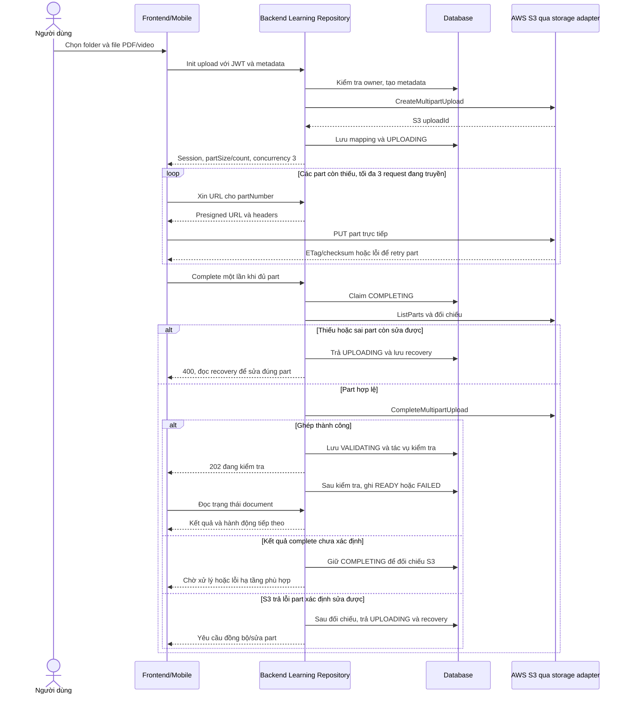

# Learning Repository — kho tài liệu học tập

## Trạng thái và quy tắc chung

**Thiết kế trước triển khai, cập nhật 2026-11-24.** Module chưa có code nghiệp vụ; S3 storage mới kiểm tra bucket. Database do người dùng thiết kế/quản lý; chỉ ghi query mẫu để đối chiếu, không tạo schema, migration hoặc index.

Trước mỗi task đọc README này và tiêu đề feature liên quan, cùng [backend/AGENTS.md](../../../AGENTS.md), [tài liệu backend](../../../../docs/backend/README.md), [auth](../auth/README.md) và [S3 storage](../../infrastructure/storage/README.md).

Tất cả feature nằm trong file này: **Folder → List tài liệu → Upload → Xem/download/xóa → Search tiêu đề → Usage**.

- Mọi endpoint cần Bearer JWT đã verify; userId lấy từ sub, không lấy từ body/query. Query luôn giới hạn resource theo user; không tồn tại/khác owner cùng `404 NOT_FOUND`.
- File/part nằm ở S3 private; backend làm việc với metadata theo contract database người dùng cung cấp. Không lưu file hoặc presigned URL vào database, không log URL ký/credentials.
- Frontend giữ File/session/ETag trong bộ nhớ; F5/thoát thì bắt đầu lượt mới. Chỉ retry part khi trang còn mở; tối đa 3 PUT đồng thời mỗi file, không cần Web Worker.
- Backend dùng ListParts nội bộ trước complete, không mở API lấy part cho frontend. Backend yêu cầu S3 ghép file; READY mới cho download. Không duy trì counter dung lượng cộng dồn trong DB.
- Cleanup gắn với thao tác upload lỗi/hủy/xóa; không bổ sung job quét định kỳ hoặc resume sau thoát.

Giữ controller, service folder/document, upload service, repository, DTO/interface/policy tại `src/module/learning-repository/`. SQL ở repository, không trong controller/service. `src/infrastructure/storage/` cung cấp thao tác S3 qua public interface, không tự quyết định ownership; không tạo client riêng trong nghiệp vụ.

## Feature 1 — Folder và cây thư mục

### API

| API | Input / kết quả |
| --- | --- |
| `POST /learning-repository/folders` | name, parentId nullable; trả `201` folder DTO |
| `GET /learning-repository/contents` | folderId nullable, cursor, limit có giới hạn; trả `200` folder/document DTO |

User tạo cây folder ở frontend. Backend lấy userId từ JWT đã verify, kiểm tra parent cùng user rồi tạo folder. Folder rỗng vẫn hiển thị dù chưa có object S3; không cần marker 0 byte.

### Cấu trúc S3

```text
<bucket>/learning-repository/<userId>/
├── <folderId>/
│   ├── <childFolderId>/<documentId>/original.pdf
│   └── <documentId>/original.mp4
└── <documentId>/original.pdf
```

Cây ID tương ứng cây folder frontend; tên hiển thị đọc từ metadata theo database người dùng cung cấp. Backend dựng key từ userId, ancestor folder ID và document ID; không nhận bucket/raw key/path tùy ý. Tên file gốc chỉ để hiển thị.

- Kiểm tra parent cùng user, tên hợp lệ, vòng cây, độ sâu và độ dài key. Chính sách trùng tên/phân biệt hoa thường cần chốt theo contract database.
- Đổi tên folder không đổi ID/key. Move cả cây làm thay đổi ancestor path cần thiết kế copy/delete riêng, chưa thuộc phạm vi này.
- List đúng user và folder, sort ổn định, cursor/limit có giới hạn; không tải toàn bộ cây lớn mỗi lần mở folder.
- Parent không tồn tại/không thuộc user: `404 NOT_FOUND`; input sai: `400 BAD_REQUEST`; xung đột tên/version theo contract: `409 CONFLICT`. Lỗi chung xem README.

Kiểm chứng: folder rỗng/nhiều cấp, parent khác user, tên không hợp lệ, trùng tên đồng thời và phân trang không lộ dữ liệu user khác.

## Feature 2 — Danh sách tài liệu đã lưu (offset)

“Khóa học đã lưu” trong phạm vi này là **tài liệu PDF/video**, không phải entity khóa học riêng.

`GET /learning-repository/documents?offset=0&limit=20&folderId=...` trả `200`: items, offset, limit, hasMore. Offset nguyên không âm, mặc định 0; limit mặc định 20, tối đa 50. Độ sâu offset có giới hạn server; folderId tùy chọn, chỉ tìm trực tiếp folder đó. Không có tài liệu trả items rỗng.

Query mẫu: lọc user/READY và lấy **ID của trang trước**, sau đó JOIN lấy chi tiết tài liệu của đúng user. Tên bảng/cột phải khớp database người dùng cung cấp; không tạo schema/index ở đây.

```sql
WITH page_ids AS MATERIALIZED (
  SELECT d.id, d.created_at
  FROM learning_documents AS d
  WHERE d.user_id = $1::uuid
    AND d.status = 'READY'
  ORDER BY d.created_at DESC, d.id DESC
  LIMIT $2::integer
  OFFSET $3::integer
)
SELECT d.id, d.title, d.filename, d.folder_id,
       d.content_type, d.size_bytes, d.created_at
FROM page_ids AS p
JOIN learning_documents AS d
  ON d.id = p.id AND d.user_id = $1::uuid
ORDER BY p.created_at DESC, p.id DESC;
```

`$1` lấy từ JWT đã verify, `$2 = limit + 1`, `$3 = offset`. Chỉ trả limit phần tử; phần tử dư xác định hasMore. Trang tiếp dùng offset + limit, không tăng theo số row lấy dư. Không COUNT toàn kho chỉ để biết còn trang hay không.

Nếu có folderId, thêm `AND d.folder_id = $4::uuid` trong page_ids bằng parameter Drizzle, kiểm tra folder thuộc user; không lọc sau LIMIT/OFFSET. Các filter bổ sung phải áp dụng trước khi chọn ID; JOIN chi tiết không được làm nhân bản row tài liệu.

MATERIALIZED giữ tập ID đã giới hạn trước bước lấy chi tiết; không bảo đảm tự dùng index. Offset lớn vẫn phải bỏ qua nhiều row và dữ liệu thêm/xóa giữa các trang có thể gây trùng/thiếu; kiểm tra execution plan theo database thực tế, không hứa tốc độ chỉ vì dùng CTE. SQL nằm trong repository và mọi giá trị đều parameter hóa.

Kiểm chứng: user khác, READY/non-READY, folder filter, offset 0/trang cuối/rỗng, limit có giới hạn, cùng createdAt vẫn sort ổn định theo id; phản hồi không lộ key/credential nội bộ.

## Feature 3 — Upload PDF/video multipart

### API upload

| API | Mục đích / kết quả |
| --- | --- |
| `POST /learning-repository/uploads` | Init với folderId, title, filename, contentType, sizeBytes; trả `201` uploadSessionId, documentId, partSize/count, uploadConcurrency=3 và expiresAt |
| `POST /learning-repository/uploads/:id/parts/presign` | Cấp/cấp lại URL PUT cho 1–3 partNumber |
| `GET /learning-repository/uploads/:id` | Đọc trạng thái upload và hướng dẫn phục hồi |
| `POST /learning-repository/uploads/:id/complete` | Nhận partNumber/ETag/checksum; kiểm tra và yêu cầu S3 ghép, trả `202` document/status |
| `DELETE /learning-repository/uploads/:id` | Abort lượt upload; `204` khi xác nhận đã hủy |

### Cấp/cấp lại presigned URL

Ví dụ xin URL cho part 2 sau khi part đó lỗi hoặc URL cũ hết hạn:

```http
POST /learning-repository/uploads/:id/parts/presign
Authorization: Bearer <accessToken>
Content-Type: application/json
```

```json
{ "partNumbers": [2] }
```

Response `200` gồm `uploadSessionId` và `parts[]`; mỗi phần tử có `partNumber`, `method: PUT`, `uploadUrl`, `headers`, `expiresAt`. Request đầu cũng dùng API này, ví dụ `[1, 2, 3]`.

Backend kiểm tra owner, session còn hạn/UPLOADING, số part nguyên và duy nhất trong phạm vi partCount. Cấp lại URL **giữ nguyên session và part đã upload**, không tạo lượt mới. URL không vượt hạn phiên/credential ký, response `Cache-Control: no-store`; không log URL hoặc trả AWS credentials.

### Luồng hoạt động

1. **Init:** frontend gửi title và metadata file/folder. Backend kiểm tra quyền, tạo metadata và gọi S3 CreateMultipartUpload; lưu mapping S3 uploadId/key. Lưu metadata thất bại sau khi tạo S3 thì phải cleanup abort có theo dõi.
2. **Chia file:** backend tính partSize động theo công thức bên dưới, lưu vào session rồi trả partSize/count và `uploadConcurrency: 3`. Frontend dùng đúng kích thước backend trả trong suốt lượt upload; file nhỏ có thể chỉ có một part cuối.
3. **Xin URL và upload:** frontend xin URL từng nhóm, chạy tối đa **3 request UploadPart đồng thời cho mỗi file**. Part nào xong lấy part tiếp theo ngay, không đợi cả nhóm. Đây là 3 tác vụ async, không cần Web Worker/thread.
4. **Ghi nhận kết quả:** mỗi PUT thành công, S3 trả ETag/checksum; frontend lưu theo partNumber. Không gọi backend hoặc complete sau mỗi part. Retry phải cập nhật ETag mới và không gửi chồng hai request cùng partNumber.
5. **Complete:** khi mọi part đã xong và không còn request đang chạy, frontend gửi danh sách theo thứ tự partNumber. Backend claim COMPLETING, ListParts đủ trang để đối chiếu rồi gọi CompleteMultipartUpload. **S3 ghép file**, backend không tải part về ghép.
6. **Kiểm tra file:** sau khi S3 xác nhận complete, backend lưu VALIDATING và tác vụ kiểm tra có quản lý; trả `202`. File hợp lệ chuyển READY; không đạt policy chuyển FAILED và dọn object. Frontend đọc trạng thái đến khi có kết quả.

#### Tính partSize động

Tính theo byte bằng phép toán số nguyên; `ceilDiv(a, b)` là chia làm tròn lên:

```text
MiB       = 1024 * 1024
baseSize  = max(16 * MiB, ceilDiv(fileSizeBytes, 10000))
partSize  = ceilDiv(baseSize, MiB) * MiB
partCount = ceilDiv(fileSizeBytes, partSize)
```

- Trước init, từ chối file rỗng hoặc vượt giới hạn file của ứng dụng/S3. Sau làm tròn, kiểm tra partSize trong 5 MiB–5 GiB và partCount từ 1 đến 10.000; không clamp partSize xuống nếu làm vượt partCount.
- Mọi part trừ part cuối có kích thước partSize; part cuối là số byte còn lại và có thể nhỏ hơn 5 MiB. Frontend không tự đổi partSize giữa chừng, retry giữ nguyên lát cắt của part đó.
- Ví dụ: 100 GiB dùng part 16 MiB, tổng 6.400 part. File vượt ngưỡng `10000 * 16 MiB` thì partSize tự tăng, không cố định 16 MiB.
- Giới hạn object phải đối chiếu nhà cung cấp khi triển khai: tài liệu AWS hiện ghi 48,8 TiB, không còn dùng mốc 5 TB làm giới hạn S3 mặc định. Ứng dụng có thể đặt giới hạn thấp hơn qua envConfig.

**Thoát/F5 là mất lượt upload ở frontend:** không chọn lại file để resume, không khôi phục session/ETag từ localStorage/IndexedDB. Khi quay lại, người dùng chọn file và bắt đầu lượt mới. Retry part chỉ hỗ trợ khi trang còn mở và còn File trong bộ nhớ. Nếu complete đã gửi thì backend vẫn đối chiếu/xử lý kết quả của lượt cũ, không hủy file đã hoàn tất chỉ vì frontend rời trang.



### Khi lỗi

| Tình huống | Cách xử lý |
| --- | --- |
| Part lỗi mạng/timeout/S3 5xx | Frontend retry cùng partNumber/lát cắt, backoff và số lần hữu hạn; part thành công được giữ. Retry cũng nằm trong pool 3 |
| URL hết hạn | Xin URL mới qua API presign nếu session còn hợp lệ. Không coi mọi lỗi 403 là hết hạn; có thể sai chữ ký/header/quyền/CORS |
| Hết lượt retry | Tạm dừng frontend, dừng lấy part mới, chờ/hủy request đang chạy; người dùng chọn tiếp tục hoặc hủy. Không tự complete/abort |
| Mất response PUT khi trang còn mở | Retry cùng partNumber từ File còn trong bộ nhớ; giữ nguyên session, dùng ETag mới khi nhận thành công |
| F5/thoát app hoặc trang bị đóng | Không khôi phục upload; lần sau chọn file và tạo lượt mới. S3 không tự abort chỉ vì đóng trang; không giả đã xóa part cũ |
| Complete thiếu/sai part khi còn File | Xác nhận lượt còn sửa được, chuyển UPLOADING và trả recovery; upload lại đúng part. Nếu chỉ ETag cũ nhưng byte đã được đối chiếu hợp lệ, backend dùng ETag thực từ S3 để ghép |
| Complete timeout, 5xx hoặc NoSuchUpload | Giữ COMPLETING, HEAD metadata/checksum đúng key và đối chiếu multipart. Có thể file đã ghép; không tự tạo lượt mới hoặc reset UPLOADING |
| S3 đã ghép nhưng DB lỗi | Reconcile object đúng document/upload rồi khôi phục VALIDATING; không ghép hoặc upload lại mù quáng |
| File ghép xong nhưng không hợp lệ | FAILED, dọn object; cần file hợp lệ mới. Không còn sửa một part của multipart đã hoàn tất |
| Lỗi hạ tầng trong bước kiểm tra file | Giữ VALIDATING, retry có quản lý/hữu hạn; không tự kết luận file hỏng |
| Người dùng hủy/hết hạn lượt | Dừng queue/request, backend claim ABORTING rồi abort. Chỉ ABORTED sau xác nhận; file đã complete cần xóa object riêng |

`GET /uploads/:id` trả status và `recovery` khi cần: reason/nextAction, missingPartNumbers, invalidPartNumbers. API phục vụ theo dõi complete/sửa part khi trang còn mở, không dùng để khôi phục upload sau thoát/F5. Frontend không parse chuỗi lỗi để đoán part; lỗi checksum toàn file không mặc nhiên xác định được part hỏng.

#### Quy tắc nhất quán

- Chỉ một thao tác được claim COMPLETING bằng conditional update và operation/lease; không giữ transaction DB trong lúc gọi S3. Lease hết hạn/process chết phải reconcile trước khi tiếp tục. S3 và DB không có transaction chung.
- Không cấp URL mới khi đã complete/abort/hết hạn. URL ký cũ không tự bị thu hồi; frontend phải dừng request cũ. Backend vẫn kiểm tra lại ETag/checksum và phân loại lỗi InvalidPart/EntityTooSmall/InvalidPartOrder.
- Complete kiểm tra danh sách đầy đủ, partNumber không trùng và đúng thứ tự, size/checksum khớp; ETag multipart không mặc nhiên là MD5 toàn file. Dùng SDK xử lý lỗi S3, gồm lỗi nhúng trong HTTP 200.
- Complete trùng khi COMPLETING/VALIDATING/READY trả `202` cùng kết quả đã lưu, không chạy ghép lần nữa. Chỉ trả `202` khi đã có trạng thái/tác vụ xử lý tiếp bền vững; nếu không bảo đảm được thì trả lỗi hạ tầng.
- Xác nhận multipart mất/đã abort và không có object hoàn tất mới kết thúc lượt thất bại; abort không xóa object đã complete. Giới hạn retry/reconcile và xử lý trạng thái kẹt phải được chốt trước code.

### Trạng thái và cleanup theo yêu cầu

| Trạng thái | Ý nghĩa |
| --- | --- |
| CREATING | Đang khởi tạo metadata và multipart |
| UPLOADING | Được xin URL, upload/retry part; pause là trạng thái frontend |
| COMPLETING | Đang ghép hoặc chưa xác định kết quả; không upload thêm |
| VALIDATING | Object đã ghép, đang kiểm tra |
| READY | Tài liệu dùng được |
| ABORTING / ABORTED | Đang hủy / đã xác nhận hủy |
| FAILED | Lượt kết thúc thất bại theo nguyên nhân đã xác định |

Lỗi part sửa được cho phép COMPLETING → UPLOADING. Không tự đổi trạng thái vì timeout khi chưa biết kết quả S3.

**Dọn dữ liệu trong luồng yêu cầu:**

- Người dùng hủy upload: backend abort multipart và xác nhận kết quả trước khi kết thúc session. Request part còn đang bay cần được kiểm tra khi xử lý abort.
- File không hợp lệ hoặc phát sinh object mồ côi trong request: xử lý cleanup tương ứng, ghi nhận lỗi nếu chưa xóa được; không báo đã dọn khi S3 thất bại.
- Người dùng xóa tài liệu: xử lý xóa object và cập nhật metadata theo kết quả đã xác nhận. Upload thành công giữ document READY, folder và metadata cần để tra cứu/recovery.
- COMPLETING chưa rõ kết quả: đối chiếu S3 khi xử lý API trạng thái/complete trước khi quyết định bước tiếp theo; không xóa record chỉ vì đã tồn tại lâu.

### Validate và cấu hình

- Chỉ PDF/video theo allowlist đề xuất PDF, MP4, WebM. Validate metadata trước init, kiểm tra byte thật/checksum và parse container sau complete; không tin đuôi file/MIME client hoặc coi parse thành công là chứng minh file vô hại.
- Giới hạn file/part, thời lượng/codec, số trang PDF, tài nguyên xử lý và policy PDF mã hóa/active content cần chốt. Không dùng giới hạn avatar cho tài liệu; không buffer toàn video vào RAM.
- Xử lý file có timeout/hủy thực sự và giới hạn CPU/bộ nhớ/concurrency; đây là bước kiểm tra backend, khác với pool 3 request frontend. Không chạy promise nền không được quản lý. Presigner và parser cần khảo sát/duyệt riêng.
- S3 bucket private, IAM giới hạn action/prefix. S3 CORS cho origin/method/header cụ thể và expose ETag/checksum; backend CORS không thay S3 CORS. Không gửi JWT/cookie ứng dụng sang S3.
- Cấu hình qua envConfig: prefix, type/size limits, partSize/count, URL/upload TTL, presign batch 1–3, rate limit, giới hạn xử lý file và usage timeout. Chuẩn S3 hiện có tối đa 10.000 part, 5 MiB–5 GiB mỗi part trừ part cuối; xác minh lại khi triển khai. Giới hạn 3 part là scheduler client, không phải S3 tự chặn request thứ tư.

### Kiểm chứng khi triển khai

Test presign 1–3 part, partSize động và các biên S3; tối đa 3 PUT kể cả retry; ETag/part lỗi; không resume sau F5; complete trùng/timeout, complete–abort đồng thời, lease và đối chiếu S3 khi DB lỗi; file không hợp lệ và cleanup theo thao tác. Test HTTP/OpenAPI, lỗi và S3 thật khi có cấu hình kiểm thử được cấp; mock không chứng minh upload thật đã chạy.

Tham khảo: [multipart](https://docs.aws.amazon.com/AmazonS3/latest/userguide/mpuoverview.html), [complete](https://docs.aws.amazon.com/AmazonS3/latest/API/API_CompleteMultipartUpload.html), [giới hạn S3](https://docs.aws.amazon.com/AmazonS3/latest/userguide/qfacts.html).

## Feature 4 — Xem, download và xóa tài liệu

| API | Kết quả |
| --- | --- |
| `GET /learning-repository/documents/:id` | `200` title, metadata, trạng thái và failureCode công khai nếu có |
| `POST /learning-repository/documents/:id/download` | `200` presigned GET và expiresAt, chỉ document READY thuộc user |
| `DELETE /learning-repository/documents/:id` | `202` khi đã nhận xử lý xóa có quản lý; chưa đồng nghĩa S3 đã xóa |

### Luồng và quy tắc

1. Verify JWT, lấy userId và tìm document thuộc đúng user. Không tồn tại hoặc khác owner đều `404 NOT_FOUND`.
2. Xem metadata qua repository theo contract database người dùng cung cấp; không trả row/trường nội bộ, raw lỗi S3 hoặc parser.
3. Download chỉ key server quản lý của document READY, URL ngắn hạn, response no-store; mặc định attachment. Không fetch URL client tùy ý, không log signed URL.
4. Xóa theo trạng thái đã claim để không xung đột complete; gọi storage xóa đúng object rồi cập nhật metadata theo kết quả thực. S3/DB không có transaction chung, lỗi một bên phải được ghi nhận/đối chiếu, không giả đã xóa.
5. Object chưa complete cần abort multipart; abort không xóa object đã complete. Cleanup diễn ra theo yêu cầu/lỗi liên quan, không thêm lịch quét định kỳ. Không tự xóa tài liệu READY.

Document đang kiểm tra/không đủ trạng thái để download hoặc xóa: `409 CONFLICT`; storage lỗi đã nhận diện: `503 STORAGE_UNAVAILABLE`. JWT/validation/DB và lỗi khác xem README. Tài liệu riêng tư, chưa bao gồm chia sẻ hoặc chuyển ownership.

Kiểm chứng: user khác, document chưa READY, URL hết hạn, xóa trùng/xóa khi complete, S3 thành công nhưng cập nhật metadata thất bại; HTTP/OpenAPI và lỗi phải khớp code thực tế.

## Feature 5 — Search theo tiêu đề

`GET /learning-repository/search?q=...&folderId=...&limit=20&cursor=...` tìm **title**, không tìm filename, nội dung PDF hoặc transcript video. Title là tiêu đề metadata được nhập khi upload; filename chỉ là tên file gốc. Q trim 1–200 ký tự; limit mặc định 20, tối đa 50; không match trả `200` items rỗng.

Database/GIN do người dùng quản lý. Query giả định search_vector đại diện **chỉ title**, dùng cùng config simple và chuẩn hóa với q; phải đối chiếu định nghĩa thực tế trước tích hợp, không tự sửa database. Tập matches chỉ giữ ID/sort key/rank; chọn ID trang trong page_ids rồi mới lấy các field chi tiết.

```sql
WITH search_query AS (
  SELECT websearch_to_tsquery('simple'::regconfig,
                             translate($2::text, '._', '  ')) AS term
), matches AS (
  SELECT d.id, d.created_at,
         ts_rank_cd(d.search_vector, q.term) AS rank
  FROM learning_documents AS d
  CROSS JOIN search_query AS q
  WHERE d.user_id = $1::uuid
    AND d.status = 'READY'
    AND numnode(q.term) > 0
    AND querytree(q.term) NOT IN ('', 'T')
    AND d.search_vector @@ q.term
), page_ids AS MATERIALIZED (
  SELECT id, created_at, rank
  FROM matches
  WHERE $3::real IS NULL
     OR (rank, created_at, id) < ($3::real, $4::timestamptz, $5::uuid)
  ORDER BY rank DESC, created_at DESC, id DESC
  LIMIT $6::integer
)
SELECT d.id, d.title, d.filename, d.folder_id,
       d.content_type, d.size_bytes, d.created_at, p.rank
FROM page_ids AS p
JOIN learning_documents AS d
  ON d.id = p.id AND d.user_id = $1::uuid
ORDER BY p.rank DESC, p.created_at DESC, p.id DESC;
```

- `$1`: userId từ JWT đã verify; `$2`: q đã validate. `$3–$5`: rank/createdAt/id từ cursor, trang đầu null; trang sau đủ bộ, giữ chính xác rank kiểu real. `$6 = limit + 1`, trả limit phần tử và cursor từ phần tử cuối được trả.
- Có folderId thì thêm `AND d.folder_id = $7::uuid` trong matches, kiểm tra ownership; không lọc sau phân trang. Chỉ tìm trực tiếp folder đó; bỏ filter thì tìm toàn kho user.
- Cursor gắn cùng q/filter/sort. Query parse rỗng/không indexable trả items rỗng, không biến thành list tất cả. Không coi full-text là substring search hoặc tự hỗ trợ bỏ dấu/tách từ tiếng Nhật.
- Repository parameter hóa query, không nối input/sql.raw, không trả search_vector/objectKey. DTO/cursor sai: `400 BAD_REQUEST`; folder khác user/không tồn tại: `404 NOT_FOUND`.

Query chưa chạy trên database thực tế. Kiểm chứng title match nhưng filename khác, filename match nhưng title không match, ownership, READY, filter trước phân trang, rank bằng nhau/cursor và execution plan. Không có DDL, migration hoặc lệnh tạo index trong tài liệu.

## Feature 6 — Dung lượng từ S3

`GET /learning-repository/usage` lấy prefix `learning-repository/<userId>/` từ JWT, gọi **ListObjectsV2 đủ trang**, không Delimiter, rồi cộng Size trong lần đọc đó. Không tải nội dung/HEAD từng file, không list cả bucket và **không lưu counter cộng dồn trong DB**. S3 không có thuộc tính tổng dung lượng folder để GET một lần.

Response gồm usedBytes dạng chuỗi số nguyên thập phân, objectCount, source `s3-list`, observedFrom/observedUntil và cờ không gồm incomplete uploads/noncurrent versions.

- Tính mọi current object hoàn tất dưới prefix, gồm file VALIDATING/FAILED chưa cleanup; objectCount không nhất thiết bằng số document READY.
- Không tính part multipart chưa complete, version cũ, delete marker hoặc toàn bộ hóa đơn AWS. Part dở dang vẫn có thể phát sinh phí; muốn tính thêm phải tổng hợp riêng.
- Scan nhiều trang không phải snapshot atomic khi upload/xóa đồng thời, không dùng làm quota atomic. Prefix phải có dấu `/` cuối để không khớp user khác.
- Có timeout/rate limit; scan lỗi/chưa hết trang thì trả lỗi, không trả 0 hoặc tổng thiếu dưới dạng thành công. Dùng số nguyên đủ chính xác; không tự thay bằng DB counter/cache. Dữ liệu quá lớn cần đề xuất cơ chế báo cáo khác trước khi đổi contract.

Kiểm chứng: prefix trống, nhiều trang, đúng user, số byte lớn, multipart chưa complete/version cũ bị loại, S3 lỗi/timeout không trả tổng thiếu. Không dùng số liệu scan làm quota atomic.

Tham khảo: [ListObjectsV2](https://docs.aws.amazon.com/AmazonS3/latest/API/API_ListObjectsV2.html).

## Lỗi chung

Body lỗi chung: `{ code, message, details, requestId }`; details là string array an toàn. Recovery có cấu trúc nằm ở status DTO, không chèn object vào details. Frontend dịch theo code; không trả/log secret, signed URL hoặc raw lỗi S3/parser. Lỗi PUT trực tiếp S3 không theo format backend nên frontend map riêng.

| HTTP | Code | Trường hợp |
| --- | --- | --- |
| 400 | BAD_REQUEST | DTO/part/ETag/checksum/size sai; part sửa được quay về UPLOADING |
| 401 | UNAUTHORIZED / INVALID_TOKEN / TOKEN_EXPIRED | JWT thiếu/sai/hết hạn; theo auth flow |
| 404 | NOT_FOUND | Resource không tồn tại hoặc không thuộc user |
| 409 | CONFLICT | Trùng tên/version cũ/trạng thái không cho phép thao tác |
| 410 | GONE | Upload hết hạn ứng dụng |
| 413 / 415 | PAYLOAD_TOO_LARGE / UNSUPPORTED_MEDIA_TYPE | Vượt giới hạn / loại file không hỗ trợ |
| 429 | TOO_MANY_REQUESTS | Rate limit/concurrency/quota theo policy đã chốt |
| 503 | STORAGE_UNAVAILABLE / DATABASE_UNAVAILABLE | Lỗi hạ tầng đã nhận diện; không giả complete/cleanup/usage thành công |
| 500 | INTERNAL_SERVER_ERROR | Lỗi ngoài dự kiến |

Dùng ErrorCode hiện có; message 5xx là fallback HTTP, details rỗng theo filter. Signed URL response có no-store; Swagger tiếng Anh ngắn gọn và khớp status/schema/auth thực tế.

## Kiểm chứng và giới hạn

Đọc checklist dưới tiêu đề feature liên quan trong README này. Khi triển khai chạy tại backend: `npm run typecheck`, `npm test`, `npm run lint`, `npm run format:check`, `npm run build`; kiểm tra HTTP/OpenAPI và lỗi. Mock không chứng minh S3/browser hoạt động thật; ghi rõ phần chưa kiểm chứng.

Giới hạn file/TTL/rate limit, cấu hình S3 và công cụ xử lý file cần chốt trước code. Task này chỉ sắp xếp tài liệu, không cài dependency hoặc thay đổi database.
