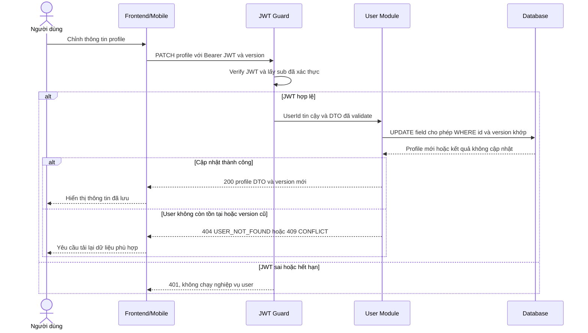
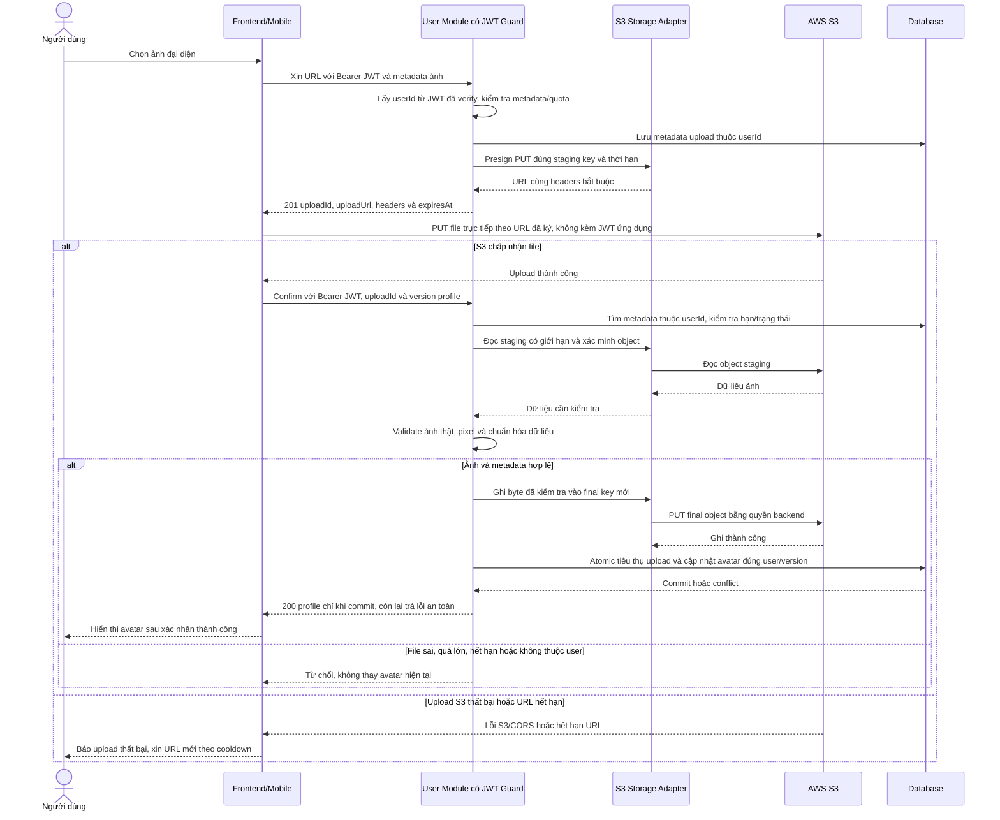
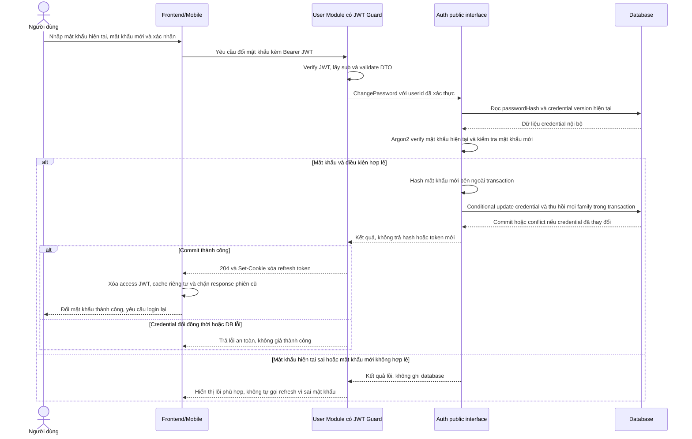

# User — profile, avatar và đổi mật khẩu

## Trạng thái và cách đọc

Ngày 2026-11-24: **tài liệu thiết kế trước triển khai**, module mới chỉ có README. Chưa có route user, Guard xác thực, schema profile/avatar, presigned upload hoặc xử lý đổi mật khẩu được triển khai. Không tự cài package, sửa code hoặc chạy migration từ tài liệu này.

Trước mỗi task, đọc lại README này cùng [backend/AGENTS.md](../../../AGENTS.md), [tài liệu backend](../../../../docs/backend/README.md), [README auth](../auth/README.md) và [README S3 storage](../../infrastructure/storage/README.md).

## 1. Danh tính và phạm vi

- Mọi API user yêu cầu access JWT qua `Authorization: Bearer <accessToken>`. Guard gọi verifier dùng chung để kiểm tra chữ ký, algorithm, issuer, audience và hạn dùng trước Controller; sau đó lấy userId từ claim `sub` đã xác thực.
- JWT được **ký**, không phải dữ liệu băm để giải mã. Không chỉ decode payload rồi tin nội dung; không đưa passwordHash, mật khẩu hoặc secret vào access JWT. `sid` chỉ sử dụng sau khi auth/common hỗ trợ thực tế.
- Không nhận userId/email/ownerId trong body/query để chọn tài khoản cần sửa. Route dùng `/users/me`; identity lấy từ ngữ cảnh xác thực. Không lấy tên hoặc avatar cũ trong JWT làm nguồn dữ liệu hiện tại: phải đọc database.
- Profile sở hữu thông tin hiển thị; auth sở hữu credential và session. Chỉnh email, role, quyền truy cập hoặc passwordHash không thuộc API cập nhật profile.
- `users` hiện chỉ có id, email, passwordHash và timestamp. Các field profile/avatar bên dưới là đề xuất, chưa có migration hoặc dữ liệu thực.

## 2. Tổ chức và trách nhiệm

```text
src/module/user/
├── README.md
├── user.module.ts
├── user.controller.ts
├── user.service.ts
├── user.repository.ts
├── policies/
│   └── avatar-upload.policy.ts
├── dto/
│   ├── update-profile.dto.ts
│   ├── user-profile.dto.ts
│   ├── request-avatar-upload.dto.ts
│   ├── avatar-upload.dto.ts
│   ├── confirm-avatar-upload.dto.ts
│   └── change-password.dto.ts
└── interfaces/
    ├── user-service.interface.ts
    └── user-repository.interface.ts
```

| Thành phần | Trách nhiệm |
| --- | --- |
| Controller | Nhận userId đã xác thực, DTO, khai báo status/Swagger; xử lý header xóa cookie sau đổi mật khẩu qua transport dùng chung |
| User service | Điều phối profile và avatar; gọi interface công khai auth để đổi mật khẩu |
| User repository | SELECT rõ field, UPDATE đúng userId; quản lý metadata lượt upload và cập nhật avatar atomic trong database |
| Auth public interface | `changePassword(userId, currentPassword, newPassword)`; verify/hash Argon2, cập nhật credential và thu hồi mọi session atomic qua repository auth |
| S3 storage public interface | Presign PUT, đọc/ghi/xóa object; không tự quyết định profile nào được gắn avatar |

User import public interface của auth và S3; không import repository auth hoặc tự tạo S3 client. Auth không import ngược UserModule; tránh dependency vòng. Nếu cần xóa refresh cookie từ cả hai module, export transport provider hẹp của auth; không import sâu file private hoặc đưa Express response vào service.

## 3. Contract API dự kiến

Các endpoint chưa tồn tại; prefix, status và schema cần khớp bootstrap/OpenAPI khi triển khai.

| API | Input | Kết quả |
| --- | --- | --- |
| `GET /users/me` | Access JWT | `200` profile của tài khoản đã xác thực |
| `PATCH /users/me/profile` | Field profile cho phép và phiên bản profile | `200` profile sau cập nhật |
| `POST /users/me/avatar/uploads` | contentType, sizeBytes | `201` uploadId, uploadUrl, method `PUT`, headers cần gửi và expiresAt |
| `POST /users/me/avatar/confirm` | uploadId, phiên bản profile | `200` profile với avatar đã xác nhận |
| `POST /users/me/password/change` | currentPassword, newPassword, confirmPassword | `204` không body; thu hồi phiên và xóa refresh cookie, yêu cầu login lại |

Profile DTO đề xuất: `id`, `email` của chính user, `displayName`, `bio`, `avatar` nullable, `version`, timestamp cần thiết. Chỉ `displayName` và `bio` được PATCH trong phạm vi này; field/giới hạn cụ thể cần chốt trước code. Không trả nguyên row hoặc trường credential. Avatar response dùng URL đọc ngắn hạn kèm expiresAt theo policy quyền sở hữu, không coi bucket là public.

`undefined` nghĩa là không sửa; `null` chỉ được dùng để xóa field được contract cho phép. `version` do server phát hành là precondition chống ghi đè dữ liệu cũ, không phải danh tính người dùng; thêm vào schema trước khi dùng. PATCH rỗng, field lạ và field ngoài phạm vi phải bị từ chối. Không tự mở API xem profile người khác hoặc đổi email từ ví dụ này.

## 4. Cập nhật profile



Repository dùng conditional update và `returning` các field công khai; không SELECT kiểm tra tồn tại nhiều lần trước UPDATE. Chỉ đọc bổ sung có giới hạn khi cần phân biệt stale version và user không tồn tại. Không lấy version/password/email trong JWT để tự ghi đè database.

## 5. Avatar — frontend upload trực tiếp lên S3

### Quy trình và metadata

1. Backend xác thực user, validate metadata, quota và rate limit; tạo uploadId và object key staging ngẫu nhiên dưới namespace của userId từ JWT. Không nhận bucket, object key, ownerId hoặc URL tùy ý từ client.
2. Lưu metadata uploadId/userId/key/type/size/expiry/trạng thái trong database qua user repository. Đây là metadata avatar, không liên quan secret OTP. Chỉ trả URL nếu metadata lưu thành công.
3. Backend dùng S3 adapter cấp presigned `PUT` đúng staging key, thời hạn ngắn và header cần thiết. Frontend gửi file thẳng S3, giữ chính xác method/header đã ký; không gửi access JWT hoặc cookie auth của ứng dụng sang S3.
4. Sau khi S3 chấp nhận upload, frontend gọi confirm bằng uploadId và version profile. Backend tra upload thuộc user đã xác thực, còn hạn và chưa dùng, kiểm tra object tồn tại và kích thước thực.
5. Backend đọc ảnh với giới hạn byte, kiểm tra nội dung thật, kích thước pixel và định dạng; decode/re-encode để tạo dữ liệu ảnh chuẩn, bỏ metadata nếu phù hợp. Ghi các byte đã kiểm tra vào **final key mới, bất biến**, do backend tạo; không gắn trực tiếp staging key vào profile.
6. User repository transaction xác nhận upload bằng conditional update và thay avatarKey/version của đúng user. S3 đọc/ghi và xử lý ảnh nằm ngoài transaction DB. Chỉ trả thành công sau DB commit.
7. Sau commit, dọn avatar cũ và staging bằng tác vụ có quản lý/retry; lỗi xóa ảnh cũ không hoàn tác avatar mới. Nếu S3 ghi final thành công nhưng DB thất bại, lên lịch dọn object mồ côi. Không chạy promise nền không được quản lý.

Presigned URL có thể dùng nhiều lần đến hết hạn và PUT lại sẽ ghi đè cùng key. Vì vậy confirm không làm URL upload mất hiệu lực; ảnh final phải tách khỏi staging và không nằm trong quyền PUT frontend. Dùng đúng các byte đã validate để tạo final, không HEAD rồi copy object staging có thể đã bị thay sau kiểm tra.



### Validate file avatar

Frontend kiểm tra để báo lỗi sớm; **backend quyết định file được chấp nhận**. Validation metadata trước presign không thay thế kiểm tra nội dung sau upload. Các giới hạn số dưới đây là đề xuất để duyệt trước code, chưa phải cấu hình đã chạy.

| Nội dung | Quy tắc dự kiến | Nơi kiểm tra |
| --- | --- | --- |
| Định dạng | Chỉ `image/jpeg`, `image/png`, `image/webp`; không nhận SVG, GIF, PDF, HTML, ZIP hoặc file thực thi | DTO allowlist trước presign; nhận diện byte và decode lại khi confirm |
| Dung lượng | Từ 1 byte đến 5 MiB (`5 * 1024 * 1024` byte), không nhận file rỗng | Frontend/DTO kiểm tra sớm; backend kiểm tra object và giới hạn stream thật |
| Kích thước ảnh | Mỗi chiều từ 1 đến 4096 pixel, tổng không quá 16.777.216 pixel | Decoder có giới hạn trước khi cấp phát ảnh đầy đủ; kiểm tra cả orientation |
| Số frame | Ảnh tĩnh, đúng một frame; từ chối WebP động hoặc PNG nhiều frame | Decoder đọc metadata/frame count và xác minh khi decode |
| Tính toàn vẹn | MIME khai báo phù hợp định dạng thực, ảnh decode hoàn chỉnh, không truncated/hỏng | Confirm bằng dữ liệu đọc từ S3; chỉ magic bytes không đủ |
| Metadata upload | Byte count thực bằng size đã khai báo và còn trong giới hạn; đúng user/uploadId, key server tạo, thời hạn và trạng thái | Metadata trong DB và nội dung object, sau đó kiểm tra lại trạng thái khi commit |
| File cuối | Re-encode từ dữ liệu đã decode/kiểm tra, bỏ EXIF/GPS và metadata không cần; MIME/đuôi key do server chọn theo output | Backend trước ghi final; không copy nguyên file nguồn chưa chuẩn hóa |

Không lấy tên file client làm object key hoặc đường dẫn. Request hiện chỉ cần type và size; nếu sau này thêm originalFilename để hiển thị thì phải giới hạn độ dài/ký tự, không dùng để quyết định MIME, chạy shell hoặc truy cập filesystem. Các giá trị `../`, ký tự điều khiển, null byte hoặc đuôi kép không được tác động đường dẫn lưu.

Thứ tự kiểm tra khi confirm:

1. Validate uploadId/version và tìm metadata thuộc userId từ JWT đã verify; không HEAD/GET key client tùy ý. Từ chối lượt không còn hạn hoặc trạng thái không hợp lệ.
2. HEAD đúng staging object để kiểm tra tồn tại, kích thước và metadata cơ bản. Header Content-Type vẫn là dữ liệu do bên upload khai báo; không tin nó là bằng chứng nội dung.
3. GET với giới hạn tổng byte và timeout; dừng/đóng stream ngay khi vượt giới hạn. Không tải object không giới hạn rồi mới kiểm tra `buffer.length`; HEAD có thể lỗi thời nếu staging bị ghi đè.
4. Nhận diện định dạng từ byte thực rồi decode bằng thư viện được duyệt, chỉ bật các decoder được hỗ trợ. Giới hạn pixel/frame, bộ nhớ, thời gian và concurrency trước khi xử lý dữ liệu lớn để chống ảnh nén nhỏ nhưng bung ra rất lớn.
5. Kiểm tra lại byte count, MIME thực, kích thước và số frame của **chính dữ liệu đã đọc**. Decode lỗi hoặc dữ liệu không khớp thì không tạo avatar final; không hạ chuẩn bằng cách tin đuôi file/Content-Type.
6. Chuẩn hóa orientation, bỏ metadata riêng tư và re-encode; giới hạn byte/pixel cả output. Ghi buffer output đã kiểm tra vào final key mới, sau đó mới conditional commit avatar trong DB. Không đọc/copy lại staging chưa được xác minh sau bước kiểm tra.

Giới hạn stream/timeout thuộc storage adapter; quy tắc loại ảnh/kích thước và orchestration thuộc `avatar-upload.policy.ts`/user service. DTO chỉ validate metadata HTTP. Không gom validation riêng avatar vào helper chung; không dùng middleware multipart làm nơi duy nhất validate vì luồng PUT đi thẳng S3, không qua backend multipart.

Giới hạn CPU/bộ nhớ và timeout phải thực sự hủy tác vụ hoặc chạy trong worker có quản lý, không chỉ `Promise.race` rồi để decoder tiếp tục chạy. Khi quá tải xử lý dùng rate limit/giới hạn concurrency; không mở transaction DB trong lúc decode. Thư viện ảnh và khả năng hỗ trợ frame/pixel limit cần được kiểm tra và duyệt trước cài.

| Validation thất bại | Lỗi API khi backend xử lý |
| --- | --- |
| Metadata thiếu/sai kiểu, size không nguyên hoặc không dương | `400 BAD_REQUEST` |
| Loại file ngoài allowlist | `415 UNSUPPORTED_MEDIA_TYPE` |
| Vượt giới hạn byte/pixel đầu vào hoặc đầu ra | `413 PAYLOAD_TOO_LARGE` |
| Ảnh rỗng/hỏng, nhiều frame, MIME hoặc size không khớp metadata | `400 INVALID_AVATAR_UPLOAD` (mã mới đã nêu trong bảng lỗi) |
| uploadId không thuộc user hoặc không tồn tại | `404 NOT_FOUND` với cùng thông báo |
| Lượt upload hết hạn | `410 AVATAR_UPLOAD_EXPIRED` (mã mới) |

File rỗng khai báo từ đầu bị `400 BAD_REQUEST`; nếu size khai báo hợp lệ nhưng object thực rỗng thì `400 INVALID_AVATAR_UPLOAD`. Khi không hợp lệ, giữ nguyên avatar cũ, đánh dấu lượt upload bị từ chối khi phù hợp và dọn staging bằng cơ chế có quản lý. Presigned PUT cũ có thể còn hiệu lực nên cần lifecycle dọn staging mồ côi sau hạn, không coi một lần DELETE là vô hiệu hóa URL. Không trả parser stack, nội dung file hoặc signed URL trong lỗi.

### Cấu hình S3 cần thiết

- `S3StoreService` hiện chỉ kiểm tra bucket, chưa có presign/read/write/delete object. Dự kiến bổ sung khả năng kỹ thuật qua interface storage; thư viện presigner và xử lý ảnh phải khảo sát, chọn phiên bản và duyệt riêng.
- Bucket private, không bật public ACL. IAM giới hạn prefix/action cần thiết; S3 CORS cho origin cụ thể, PUT và header đúng contract. Backend CORS không thay S3 bucket CORS.
- Đề xuất ban đầu: JPEG/PNG/WebP, tối đa 5 MiB, URL tối đa 5 phút; đây là giá trị cần duyệt trước triển khai, cùng giới hạn pixel và thời hạn metadata upload.
- Khai báo type/size trong request chỉ là kiểm tra sớm; không tin MIME/đuôi file/client size. Presigned PUT không tự tạo policy `content-length-range` như presigned POST. Bắt buộc giới hạn/quota và xác minh byte thật trước khi công bố ảnh; nếu cần chặn cứng kích thước ngay tại S3 phải thiết kế presigned POST hoặc cơ chế tương đương riêng.
- Không log presigned URL hoặc trả AWS credentials. Response có signed URL dùng `Cache-Control: no-store`; không lưu signed URL vào cột avatar, chỉ lưu final object key. GET profile chỉ sinh URL đọc từ key do server sở hữu, không fetch URL client tùy ý.
- Confirm lặp của upload đã commit có thể trả avatar hiện tại nếu cùng kết quả đã lưu; không tạo final object mới hoặc ghi đè một avatar mới hơn. Request đồng thời phải được kiểm tra lại trạng thái/version trong transaction; dọn các final key không được gắn.

## 6. Đổi mật khẩu có xác thực

Khác với quên mật khẩu: người dùng phải có JWT hợp lệ và biết mật khẩu hiện tại. DTO nhận `currentPassword`, `newPassword`, `confirmPassword`; validate new/confirm giống nhau, giới hạn theo policy và không trim/chuẩn hóa mật khẩu. Không lấy passwordHash từ JWT.

User service gọi interface công khai `auth.changePassword(userId, currentPassword, newPassword)`. Auth đọc hash/credential version mới nhất theo userId, Argon2 verify mật khẩu hiện tại, từ chối mật khẩu mới trùng mật khẩu hiện tại rồi tạo hash mới. Auth repository giữ một transaction conditional update theo phiên bản/hash cũ và thu hồi tất cả family/refresh token; không chia thành hai transaction giữa user và auth.



Auth không nhận Express response. Controller xóa refresh cookie bằng transport công khai đã được chuẩn bị, cùng tên/Path/Domain của auth, sau commit thành công. Các thiết bị khác có thể giữ cookie nhưng refresh bị từ chối vì family đã revoke. Access JWT đã phát hành có thể vẫn dùng đến exp theo policy auth hiện tại; nếu yêu cầu vô hiệu hóa ngay phải triển khai Guard kiểm tra credential/session version riêng, không coi chữ ký JWT tự cập nhật khi đổi mật khẩu.

## 7. Lỗi trả cho người dùng

Body theo `{ code, message, details, requestId }`, `details` là `string[]` an toàn; frontend dịch theo code, không hiển thị SQL, AWS URL, password hoặc hash. Mọi mã **mới** cần được bổ sung vào `ErrorCode` và test trong task code; chưa được enum/filter hiện tại nhận diện.

| HTTP | Code | Trường hợp | Thông báo API dự kiến / xử lý frontend |
| --- | --- | --- | --- |
| 401 | `UNAUTHORIZED` | Thiếu Bearer JWT | `Authentication required`; về login |
| 401 | `INVALID_TOKEN` | JWT sai chữ ký/claim hoặc không hợp lệ | `Invalid token`; không chạy user service |
| 401 | `TOKEN_EXPIRED` | Access JWT hết hạn | `Token expired`; refresh single-flight theo auth |
| 400 | `BAD_REQUEST` | DTO sai, new/confirm không khớp, PATCH rỗng/field cấm | `Bad Request`; hiển thị details an toàn |
| 404 | `USER_NOT_FOUND` | sub hợp lệ nhưng user đã bị xóa | `User not found`; kết thúc state tài khoản hiện tại |
| 409 | `CONFLICT` | Profile/credential version đã đổi trong request khác | `Resource has changed`; tải lại hoặc đăng nhập lại phù hợp |
| 400 | `INVALID_CURRENT_PASSWORD` **mới** | Argon2 verify mật khẩu hiện tại thất bại | `Current password is incorrect`; nhập lại, không refresh JWT |
| 400 | `PASSWORD_SAME_AS_CURRENT` **mới** | Mật khẩu mới trùng mật khẩu hiện tại | `New password must differ from current password` |
| 415 | `UNSUPPORTED_MEDIA_TYPE` | Định dạng ảnh không hỗ trợ | `Unsupported image type`; chọn ảnh khác |
| 413 | `PAYLOAD_TOO_LARGE` | Kích thước byte/pixel vượt contract | `Image exceeds the allowed size`; giảm kích thước |
| 404 | `NOT_FOUND` | uploadId không tồn tại hoặc không thuộc user | `Upload not found`; không phân biệt chủ sở hữu khác |
| 410 | `AVATAR_UPLOAD_EXPIRED` **mới** | Metadata upload hết hạn khi confirm | `Avatar upload has expired`; xin lượt upload mới |
| 400 | `INVALID_AVATAR_UPLOAD` **mới** | Chưa có object, ảnh hỏng hoặc không khớp metadata | `Invalid avatar upload`; upload lại đúng luồng |
| 429 | `TOO_MANY_REQUESTS` | Vượt quota/rate limit upload hoặc đổi mật khẩu | `Too many requests`; tuân thủ Retry-After nếu có |
| 503 | `STORAGE_UNAVAILABLE` | Storage tắt/lỗi đã được nhận diện | `Service Unavailable`; giữ avatar cũ, thử lại sau |
| 503 | `DATABASE_UNAVAILABLE` | DB unavailable đã được nhận diện | `Service Unavailable`; không giả cập nhật thành công |
| 500 | `INTERNAL_SERVER_ERROR` | Lỗi chưa biết hoặc xử lý ảnh/mật mã thất bại ngoài dự kiến | `Internal Server Error`; dùng requestId hỗ trợ |

Các API đều có thể trả validation/auth/rate limit/hạ tầng khi liên quan. Lỗi avatar chỉ thuộc endpoint avatar; lỗi mật khẩu chỉ thuộc change password. Mã `UNSUPPORTED_MEDIA_TYPE`/`PAYLOAD_TOO_LARGE` hiện có nhưng chỉ trả khi lớp kiểm tra tương ứng được triển khai. Lỗi trực tiếp từ S3 ở bước PUT không có format lỗi backend trên; frontend phải map lỗi upload riêng, không hiển thị raw response hoặc signed URL.

Filter hiện thay message mọi lỗi 5xx thành HTTP reason phrase và details rỗng, nên bảng giữ đúng fallback. Swagger mô tả tiếng Anh ngắn gọn, đúng status/schema/auth đã triển khai; `204` không body.

## 8. Dữ liệu và kiểm thử cần triển khai

- Schema đề xuất: field profile, avatar final key và version; metadata upload có ownership, thời hạn và kết quả confirm. Credential version/session/family thuộc thiết kế auth. Tạo migration và duyệt trước khi chạy, không suy ra các cột đã có.
- Profile: validate/field whitelist, thiếu user, optimistic concurrency, không sửa user khác, response không có passwordHash hoặc trường nội bộ.
- JWT: thiếu/sai/hết hạn, không tin decode, userId ngoài body không ghi đè sub; interface user gọi auth/storage công khai và không có dependency vòng.
- Avatar unit/integration: presign chỉ đúng key/user, headers, expiry; PUT thành công chưa tự gắn avatar; confirm sai owner, hết hạn, ảnh sai/quá lớn, staging ghi đè sau kiểm tra không đổi final; hai confirm/race profile và rollback DB/cleanup có quản lý.
- File validation: 0 byte, đúng/vượt 5 MiB, MIME giả, HTML/SVG/ZIP đổi đuôi JPG, ảnh truncated, GIF/WebP/APNG nhiều frame, ảnh nén có pixel quá lớn; test ngay dưới/đúng/vượt từng giới hạn và output sau re-encode. Dùng fixture giả có kiểm soát, không tải ảnh riêng tư.
- Stream/decoder: object thay đổi sau HEAD, size thực không khớp, đọc quá byte, timeout hủy công việc, concurrency có giới hạn, metadata EXIF/GPS bị loại, ảnh final chỉ được ghi từ buffer đã validate; mọi lỗi giữ avatar cũ và dọn staging đúng policy.
- Storage: mock mặc định; kiểm chứng S3 IAM/CORS/presigned PUT và đọc ảnh trên bucket kiểm thử khi cấu hình được cấp. Chưa được gọi là upload thật thành công chỉ vì HeadBucket pass.
- Password: đúng/sai currentPassword, mismatch confirm, trùng mật khẩu, hash mới thật, race đổi/reset/login, rollback giữ credential/session nhất quán, thu hồi tất cả family và xóa cookie đúng scope khi thành công.
- HTTP/OpenAPI: route/method, Bearer auth, DTO/required fields, response/lỗi theo bảng, requestId, no-store khi signed URL, status 204 không body; cookie jar kiểm tra không refresh được sau đổi mật khẩu.
- Chạy trong `backend/`: `npm run typecheck`, `npm test`, `npm run lint`, `npm run format:check`, `npm run build`. Báo rõ các kiểm tra runtime/S3/native chưa chạy.

## Tham khảo

- [AWS S3: upload bằng presigned URL](https://docs.aws.amazon.com/AmazonS3/latest/userguide/PresignedUrlUploadObject.html).
- [AWS S3: thời hạn và khả năng dùng lại presigned URL](https://docs.aws.amazon.com/AmazonS3/latest/userguide/using-presigned-url.html).
- [OWASP: kiểm tra loại, nội dung và giới hạn file upload](https://cheatsheetseries.owasp.org/cheatsheets/File_Upload_Cheat_Sheet.html).
