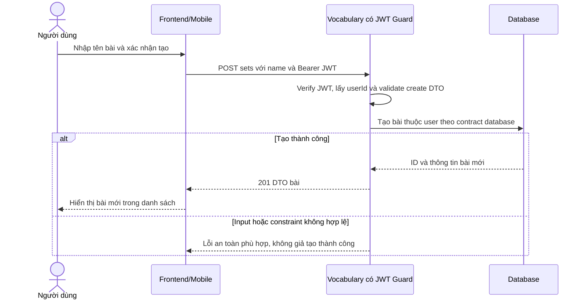
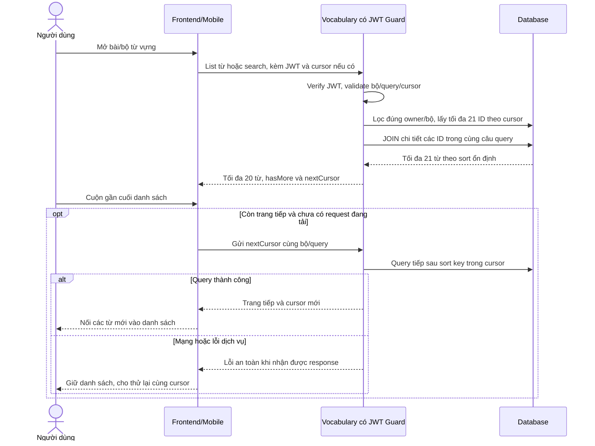
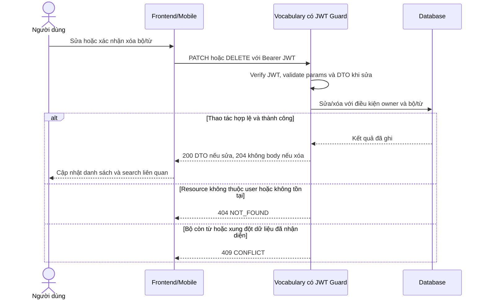

# Vocabulary — bài/bộ và danh sách từ vựng

## Trạng thái và phạm vi

**Thiết kế trước triển khai, 2026-11-24.** Module mới có README, chưa có API/code vocabulary. Database do người dùng quản lý; chỉ ghi query mẫu, không tạo bảng/cột/index hoặc migration.

Trước mỗi task đọc lại README này, [hướng dẫn backend](../../../AGENTS.md), [tài liệu backend](../../../../docs/backend/README.md) và [auth](../auth/README.md).

Luồng sản phẩm đã chốt: **màn ngoài list bài/bộ → chọn bộ → list từ → search hoặc cuộn tải thêm 20 từ**. Bài/bộ ở đây là collection từ vựng, không phải tài liệu PDF/video trong Learning Repository.

**Phạm vi thiết kế gồm tạo bài/bộ, insert danh sách từ, GET, PATCH và DELETE**. API tạo bài nhận tên bài; API insert nhận một mảng từ để thêm thẳng vào bài của user. Các API trong tài liệu chưa được triển khai.

- API cần Bearer JWT đã verify, lấy userId từ sub. Không nhận userId/ownerId trong body/query để chọn chủ sở hữu.
- Bộ và từ phải thuộc tài khoản đang thao tác. Kiểm tra cả setId và wordId; resource không tồn tại/khác owner cùng `404 NOT_FOUND`.
- Controller nhận DTO, service điều phối nghiệp vụ, repository giữ SQL; code dự kiến ở `src/module/vocabulary/`, DTO/interface riêng trong module. Không đưa nghiệp vụ vào common hoặc import repository module khác.

## Feature 1 — Tạo bài/bộ và API đọc

| API dự kiến | Mục đích / kết quả |
| --- | --- |
| `POST /vocabulary/sets` | Nhận name, description tùy chọn; tạo bài của user từ JWT, `201` DTO bài |
| `POST /vocabulary/sets/:setId/words/bulk` | Nhận words[], bulk insert vào bài của user, `201` insertedCount và items |
| `GET /vocabulary/sets` | List bài/bộ của user ở màn ngoài, cursor, tối đa 20 bài/lần |
| `GET /vocabulary/sets/:setId` | Chi tiết bài/bộ, `200` DTO |
| `GET /vocabulary/sets/:setId/words` | List tối đa 20 từ theo cursor, `200` DTO phân trang |
| `GET /vocabulary/sets/:setId/words/search` | Search full-text trong bộ, tối đa 20 từ theo cursor |
| `GET /vocabulary/sets/:setId/words/:wordId` | Chi tiết từ, `200` DTO |

Contract response đề xuất: bộ có name/description; từ có word, reading, meaning, example. Kiểu/nullability theo database được cung cấp; response chỉ lấy field công khai cùng ID/timestamp cần thiết, không trả nguyên row. Đây là tên field nghiệp vụ để đọc, không phải yêu cầu tạo schema.

DTO validate params/query/cursor và từ chối field lạ; các API GET không nhận body thay đổi dữ liệu. Đăng ký route search trước route `:wordId` hoặc có ràng buộc tương ứng để chuỗi search không bị hiểu là ID từ.

### Tạo tên bài

```http
POST /vocabulary/sets
Authorization: Bearer <accessToken>
Content-Type: application/json
```

```json
{ "name": "Bài 1 — Từ vựng N5" }
```

DTO create riêng: name là chuỗi bắt buộc, trim và không được rỗng, độ dài theo contract đã chốt; description tùy chọn. Không nhận userId/ownerId/ID/timestamp từ client. Backend tạo bài gắn user đã xác thực, trả `201` gồm id, name, description và timestamp công khai; frontend cập nhật/refetch danh sách bài rồi có thể mở bài mới với list từ rỗng.

Name sai/field thừa trả `400 BAD_REQUEST`; tên xung đột chỉ trả `409 CONFLICT` nếu contract database có quy tắc này. Không SELECT kiểm tra tồn tại nhiều lần để thay constraint và không tự thêm ràng buộc/schema.



## Feature 2 — List bài/bộ và list từ

- Màn ngoài: `GET /vocabulary/sets?cursor=...`; list đúng user, tối đa 20 bài/lần theo createdAt DESC, id DESC. Backend lấy 21 để xác định hasMore, trả items/limit/hasMore/nextCursor như list từ. Không tải toàn bộ từ trong từng bộ hoặc chạy query N+1 cho từng bài.
- Màn trong: `GET /vocabulary/sets/:setId/words?cursor=...`; mỗi lần trả **tối đa 20 từ** thuộc bộ được chọn. Trang đầu không có cursor; trang sau dùng nextCursor server đã trả.
- Thứ tự list từ: createdAt DESC, id DESC. Cursor gồm đủ hai giá trị, version và phạm vi bộ/filter; không dựa vào ID đơn lẻ hoặc OFFSET. Đây là các từ kế tiếp trong danh sách, chưa bao gồm tracking đã học/chưa học.

### Query list bài

```sql
WITH page_ids AS MATERIALIZED (
  SELECT s.id, s.created_at
  FROM vocabulary_sets AS s
  WHERE s.user_id = $1::uuid
    AND ($2::timestamptz IS NULL
         OR (s.created_at, s.id) < ($2::timestamptz, $3::uuid))
  ORDER BY s.created_at DESC, s.id DESC
  LIMIT 21
)
SELECT s.id, s.name, s.description, s.created_at
FROM page_ids AS p
JOIN vocabulary_sets AS s ON s.id = p.id AND s.user_id = $1::uuid
ORDER BY p.created_at DESC, p.id DESC;
```

`$1` lấy từ JWT; `$2/$3` là createdAt/id từ cursor đã validate, trang đầu null. Lọc owner và lấy ID trang trước, sau đó lấy chi tiết bài. Tên bảng/cột theo database người dùng cung cấp; query mẫu không tạo schema.

### Query list từ: lấy ID trang trước, lấy chi tiết sau

Tên bảng/cột là mẫu; điều chỉnh theo database người dùng cung cấp. SQL ở repository và mọi giá trị đều parameter hóa.

```sql
WITH page_ids AS MATERIALIZED (
  SELECT v.id, v.created_at
  FROM vocabulary_words AS v
  WHERE v.set_id = $2::uuid
    AND EXISTS (
      SELECT 1 FROM vocabulary_sets AS s
      WHERE s.id = v.set_id AND s.user_id = $1::uuid
    )
    AND ($3::timestamptz IS NULL
         OR (v.created_at, v.id) < ($3::timestamptz, $4::uuid))
  ORDER BY v.created_at DESC, v.id DESC
  LIMIT 21
)
SELECT v.id, v.set_id, v.word, v.reading,
       v.meaning, v.example, v.created_at
FROM page_ids AS p
JOIN vocabulary_words AS v ON v.id = p.id AND v.set_id = $2::uuid
ORDER BY p.created_at DESC, p.id DESC;
```

`$1` là userId từ JWT, `$2` là setId; `$3/$4` là createdAt/id đã validate từ cursor, giữ đủ độ chính xác timestamp của DB. Trang đầu truyền null, trang sau phải đủ cặp. Bộ không tồn tại/khác owner trả 404 theo kiểm tra nghiệp vụ có giới hạn; bộ hợp lệ nhưng chưa có từ trả 200 items rỗng. Giữ điều kiện ownership trong SQL dù service đã kiểm tra bộ.

## Feature 3 — Vocabulary Search bằng full-text/GIN

`GET /vocabulary/sets/:setId/words/search?q=...&cursor=...` tìm trong **word, reading và meaning** của bộ đã chọn. Q bắt buộc, trim, từ 1–200 ký tự; cùng quy tắc phân trang **20 từ**. Không tự tìm xuyên bộ hoặc qua tài khoản khác.

GIN/search_vector do người dùng thiết kế. Query giả định vector đại diện các field trên, dùng cùng config `simple` với q; phải đối chiếu cấu hình/tokenizer thực tế trước tích hợp. Không tạo index/cột hoặc dùng `ILIKE '%q%'` thay cho full-text mặc định.

```sql
WITH search_query AS (
  SELECT websearch_to_tsquery('simple'::regconfig, $5::text) AS term
), page_ids AS MATERIALIZED (
  SELECT v.id, v.created_at
  FROM vocabulary_words AS v
  CROSS JOIN search_query AS q
  WHERE v.set_id = $2::uuid
    AND EXISTS (
      SELECT 1 FROM vocabulary_sets AS s
      WHERE s.id = v.set_id AND s.user_id = $1::uuid
    )
    AND numnode(q.term) > 0
    AND querytree(q.term) NOT IN ('', 'T')
    AND v.search_vector @@ q.term
    AND ($3::timestamptz IS NULL
         OR (v.created_at, v.id) < ($3::timestamptz, $4::uuid))
  ORDER BY v.created_at DESC, v.id DESC
  LIMIT 21
)
SELECT v.id, v.set_id, v.word, v.reading,
       v.meaning, v.example, v.created_at
FROM page_ids AS p
JOIN vocabulary_words AS v ON v.id = p.id AND v.set_id = $2::uuid
ORDER BY p.created_at DESC, p.id DESC;
```

Tham số giống list, thêm `$5` là q đã validate. Search match bằng @@, vẫn sort createdAt/id để dùng cùng cursor ổn định; chưa xếp theo relevance rank. Lọc query/owner/bộ trước LIMIT, rồi mới JOIN chi tiết. Query parse rỗng/không có phần indexable trả items rỗng, không biến thành list toàn bộ bộ từ.

Đổi q/bộ/filter phải bỏ cursor cũ và tải trang đầu. Không log từ khóa riêng tư; không nối q vào SQL. Full-text simple không mặc nhiên xử lý tách từ tiếng Nhật, chuyển kana/romaji hoặc bỏ dấu tiếng Việt: cần kiểm thử dữ liệu Nhật/Việt và chốt normalization/tokenizer tương ứng với database.

## Feature 4 — Cursor pagination, cuộn tải 20 từ

Backend lấy **21 row**, chỉ trả 20. Có row thứ 21 thì hasMore=true và nextCursor lấy từ **row thứ 20 đã trả**, không lấy từ row dư; nếu không còn trang thì hasMore=false, nextCursor=null.

```json
{
  "items": [],
  "limit": 20,
  "hasMore": false,
  "nextCursor": null
}
```

- Cursor opaque do server encode, validate cấu trúc/kiểu/version và ràng buộc đúng setId/query/filter/sort. Không dùng cursor để cấp quyền; userId vẫn từ JWT.
- Frontend gần cuối danh sách thì gọi trang tiếp với nextCursor. Một request tải thêm chạy tại một thời điểm cho mỗi bộ/query; lỗi thì giữ các từ đã có, cho retry cùng cursor, không tự tăng cursor khi request thất bại.
- Merge theo wordId để tránh append trùng khi retry; đổi bộ/search thì hủy hoặc bỏ response cũ và reset danh sách. Không gọi tiếp khi hasMore=false; không dùng số trang/offset cho luồng cuộn này.
- createdAt dùng làm sort key bất biến; nếu sửa được phải chốt policy pagination tương ứng. Từ mới chèn trước cursor không tự xuất hiện ở trang tiếp, refresh để thấy; không cam kết snapshot bất biến qua nhiều request.



## Feature 5 — Sửa và xóa bài/bộ, từ vựng

| API dự kiến | Input / kết quả |
| --- | --- |
| `PATCH /vocabulary/sets/:setId` | name/description được phép sửa; `200` DTO bộ sau cập nhật |
| `DELETE /vocabulary/sets/:setId` | Xóa bộ của user theo policy bên dưới; `204` không body |
| `PATCH /vocabulary/sets/:setId/words/:wordId` | word/reading/meaning/example được phép sửa; `200` DTO từ sau cập nhật |
| `DELETE /vocabulary/sets/:setId/words/:wordId` | Xóa từ đúng bộ và user; `204` không body |

- UserId chỉ lấy từ JWT đã verify. Query sửa/xóa phải lọc owner, setId và wordId liên quan; không dựa riêng vào kiểm tra quyền ở Controller rồi UPDATE/DELETE theo ID không có phạm vi.
- DTO sửa bộ/từ tách riêng. PATCH rỗng, field lạ, field bắt buộc rỗng hoặc vượt giới hạn đã chốt trả `400 BAD_REQUEST`. Chỉ sửa field được gửi; null chỉ xóa field nullable theo contract database. Không nhận ownerId/userId/setId để chuyển chủ hoặc chuyển bộ.
- Repository dùng conditional update/delete và returning rõ field. Không tìm thấy resource trong phạm vi user trả `404 NOT_FOUND`; chỉ chuyển constraint/xung đột đã nhận diện thành `409 CONFLICT`, không biến mọi lỗi DB thành conflict.
- Thiết kế ban đầu xóa bộ còn chứa từ trả `409 CONFLICT`; xóa từ trước rồi xóa bộ. Không tự thêm bulk/cascade delete; kiểm tra ràng buộc theo database người dùng cung cấp để xử lý cả request đồng thời.
- Nếu thao tác cần nhiều câu ghi dữ liệu atomic, giữ trong một phương thức repository/transaction ngắn. Không tạo bảng/index/migration từ yêu cầu này. Cơ chế cập nhật search_vector khi sửa word/reading/meaning cần khớp contract database để search không trả kết quả cũ.
- Frontend sau sửa/xóa invalidate/refetch list bộ, list từ và search liên quan; bỏ response cũ để không thêm lại từ đã xóa. Không đổi createdAt dùng làm cursor chỉ vì nội dung được sửa.



## Feature 6 — Insert danh sách từ vào bài

```http
POST /vocabulary/sets/:setId/words/bulk
Authorization: Bearer <accessToken>
Content-Type: application/json
```

```json
{
  "words": [
    { "word": "猫", "reading": "ねこ", "meaning": "Con mèo" },
    { "word": "犬", "reading": "いぬ", "meaning": "Con chó", "example": "犬がいます。" }
  ]
}
```

- Nhận mảng không rỗng, có giới hạn batch cần chốt trước code. DTO validate toàn bộ phần tử: word/meaning là chuỗi không rỗng, reading/example theo nullability/giới hạn đã thống nhất; từ chối field lạ, ID, ownerId/userId/setId ngoài params đã validate.
- UserId lấy từ JWT đã verify; setId từ route. **Insert thẳng một batch bằng một câu SQL**, không SELECT kiểm tra từng từ rồi INSERT trong for/Promise.all, không tự đưa qua queue hoặc xử lý nền.
- Kết quả `201` có insertedCount và items DTO đã tạo; không mặc định items có thứ tự bằng input. Frontend invalidate/refetch list từ, search và thông tin bài liên quan; pagination đọc vẫn 20 từ/lần.

### Query bulk insert

Tên bảng/cột theo database người dùng cung cấp. `$1` là userId đã xác thực, `$2` là setId, `$3` là JSON array words đã validate và parameter hóa.

```sql
INSERT INTO vocabulary_words (set_id, word, reading, meaning, example)
SELECT s.id, w.word, w.reading, w.meaning, w.example
FROM vocabulary_sets AS s
CROSS JOIN jsonb_to_recordset($3::jsonb)
  AS w(word text, reading text, meaning text, example text)
WHERE s.id = $2::uuid
  AND s.user_id = $1::uuid
RETURNING id, set_id, word, reading, meaning, example, created_at;
```

Ownership được lọc ngay trong INSERT SELECT, không lấy owner từ mảng client. Bài không tồn tại/không thuộc user thì không insert row nào và trả `404 NOT_FOUND`. Một phần tử sai DTO thì từ chối toàn request trước SQL; lỗi constraint đã nhận diện trả `409 CONFLICT`, không tự ON CONFLICT DO NOTHING hoặc upsert để bỏ qua từ.

Batch phải cùng thành công hoặc rollback theo contract database; nếu có thêm thao tác ghi thì giữ trong một repository transaction. Không tạo/schema/migration từ query mẫu này. Cơ chế search_vector do database người dùng quản lý phải phản ánh từ vừa insert để search đọc được dữ liệu mới.

```mermaid
sequenceDiagram
    participant Client as Frontend/Mobile
    participant API as Vocabulary có JWT Guard
    participant DB as Database
    Client->>API: Gửi words[] và setId kèm JWT
    API->>API: Lấy userId đã verify, validate toàn mảng
    API->>DB: Một INSERT SELECT lọc đúng bài của user
    alt Insert toàn batch thành công
        DB-->>API: Các từ đã tạo
        API-->>Client: 201 insertedCount và items
    else Không có quyền, input sai hoặc constraint lỗi
        API-->>Client: 404, 400 hoặc 409 theo lỗi; không báo thành công một phần
    end
```

## Lỗi và kiểm chứng

Body lỗi theo `{ code, message, details, requestId }`; details là string array an toàn, frontend dịch theo code. Dùng ErrorCode hiện có, không trả SQL, cấu hình index hoặc dữ liệu của user khác.

| HTTP | Code | Trường hợp |
| --- | --- | --- |
| 400 | BAD_REQUEST | Params/query/cursor/DTO sai, field lạ hoặc PATCH rỗng |
| 401 | UNAUTHORIZED / INVALID_TOKEN / TOKEN_EXPIRED | JWT thiếu/sai/hết hạn |
| 404 | NOT_FOUND | Bộ/từ không tồn tại hoặc không thuộc user/bộ được chọn |
| 409 | CONFLICT | Constraint batch insert/tên bài đã nhận diện, bộ còn từ khi xóa hoặc xung đột cập nhật |
| 429 | TOO_MANY_REQUESTS | Vượt rate limit theo cấu hình đã chốt |
| 503 | DATABASE_UNAVAILABLE | DB unavailable đã nhận diện |
| 500 | INTERNAL_SERVER_ERROR | Lỗi ngoài dự kiến |

Không match hoặc list hết trang là 200, không phải lỗi 404. Filter hiện dùng message fallback HTTP/details rỗng cho 5xx. Swagger tiếng Anh ngắn gọn, đúng DTO/status/auth của API thực sự triển khai; DELETE thành công trả 204 không body.

Khi triển khai kiểm tra GET và ownership, set/word khác user, q ký hiệu/Unicode, tokenizer Nhật/Việt; list 0/19/20/21/40/41 từ, nhiều row cùng createdAt, cursor sai bộ/q, dữ liệu nguồn thay đổi giữa các trang, retry/response đến muộn và không append trùng. Xác nhận query chọn ID sau đủ điều kiện và trước lấy chi tiết; CTE không tự bảo đảm index hoặc tốc độ, cần đối chiếu execution plan với database thực tế.

Sửa/xóa cần test ownership, từ thuộc bộ khác, DTO field cấm/rỗng/null, xóa bộ còn từ, request đồng thời/constraint, response không lộ row nội bộ, search phản ánh dữ liệu đã sửa và frontend không khôi phục từ đã xóa từ response cũ.

Tạo/list bài cần test name bắt buộc/trim/field thừa, không nhận ownerId, bài gắn đúng user từ JWT, status 201, list không có bài user khác và pagination 20 bài. Bulk insert cần test mảng rỗng/quá giới hạn, một phần tử sai từ chối cả mảng, bài user khác, constraint/rollback toàn batch, không N query cho N từ, insertedCount và search đọc được từ mới.

Chạy typecheck, unit/integration test, lint, format check và build khi có code. Hiện chỉ kiểm chứng tài liệu; chưa chạy SQL trên database người dùng và chưa triển khai API tạo bài/insert batch/đọc/sửa/xóa/search/pagination.

## Kiến thức áp dụng

| Feature | Kiến thức chính |
| --- | --- |
| Tạo tên bài | Create DTO, userId từ JWT, insert theo contract DB, status 201 và cập nhật danh sách |
| Insert danh sách từ | Validate mảng lồng nhau, bulk INSERT SELECT, ownership và atomic batch |
| Đọc bài/bộ và từ | DTO params/query/response, ownership, service/repository và HTTP status |
| Sửa/xóa bài/bộ và từ | DTO riêng, conditional update/delete, constraint, transaction khi cần và cache invalidation |
| Full-text search | tsvector/tsquery, @@, GIN và tokenizer theo ngôn ngữ |
| Cuộn 20 từ | Keyset cursor theo createdAt/id, limit+1, hasMore/nextCursor và xử lý request trùng/cũ |

Tham khảo: [PostgreSQL full-text](https://www.postgresql.org/docs/current/textsearch-controls.html), [so sánh tuple cho cursor](https://www.postgresql.org/docs/current/functions-comparisons.html).
