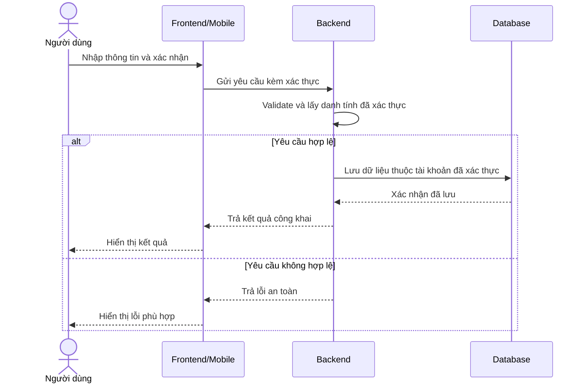

# Quy tắc AI và phê duyệt

Áp dụng cho repository NihongoHub, cùng [AGENTS.md](../../AGENTS.md) và hướng dẫn gần nhất của ứng dụng: [backend](../../backend/AGENTS.md), [mobile](../../mobile/AGENTS.md).

## Quy trình triển khai

1. Đọc hướng dẫn đúng phạm vi, khảo sát code/cấu hình và working tree.
2. Đề xuất giải pháp có mục tiêu, luồng xử lý, file thay đổi, dependency, kiểm chứng và tiêu chí hoàn thành.
3. Chờ phê duyệt task cụ thể trước khi viết/sửa code, test, dependency hoặc cấu hình chạy/build.
4. Triển khai trong phạm vi đã duyệt; kiểm tra kết quả thực tế và cập nhật tài liệu liên quan.
5. Báo ngắn gọn kết quả, check đã chạy, check chưa đạt và giới hạn còn lại.

Plan gồm nhiều task phải được duyệt từng task. Duyệt kế hoạch tổng quan không mặc nhiên duyệt mọi thay đổi. Khi đổi hướng hoặc mở rộng phạm vi đáng kể, trình bày lại phần thay đổi cần duyệt.

Yêu cầu chỉ đọc, review hoặc chỉnh tài liệu theo nội dung người dùng đã chỉ định không cần thêm vòng duyệt plan code. Phê duyệt và chỉ dẫn cụ thể đã có trong task phải được ghi nhận; không hỏi lặp lại cùng một quyền đã được cấp.

## Đọc README của module trước khi làm việc

- Trước mỗi lần khảo sát, đề xuất, viết/sửa code hoặc test cho một module frontend (kể cả mobile) hay backend, phải đọc lại `README.md` nằm trong thư mục module đó, kể cả khi đã đọc ở task trước. README cấp ứng dụng không thay thế README của module.
- Đọc mục đích, ranh giới trách nhiệm, interface công khai, dependency, luồng dữ liệu và cách kiểm thử được module hướng dẫn; đối chiếu với code thực tế trước khi thay đổi.
- Nếu task tác động nhiều module, đọc README của từng module bị ảnh hưởng trước khi làm phần tương ứng.
- Nếu module chưa có README, báo rõ phần còn thiếu, đọc hướng dẫn ở thư mục cha gần nhất và khảo sát code; không suy diễn tài liệu chưa tồn tại. Khi tạo module mới, thêm `README.md` ngay trong thư mục module; khi đổi trách nhiệm, contract hoặc cách chạy/test, cập nhật README tương ứng trong phạm vi task.

## Viết thiết kế vào README trước khi triển khai

- Trước khi triển khai module mới hoặc thay đổi luồng nghiệp vụ, viết thiết kế vào `README.md` ngay trong thư mục module để AI và lập trình viên đọc ở task sau. Ghi rõ phần đề xuất, phần đã được duyệt và phần đã triển khai; tài liệu thiết kế không tự cho phép sửa code.
- README cần có mục đích, phạm vi, interface/contract dự kiến, trách nhiệm các bên, luồng thành công/lỗi, dependency, cấu hình và cách kiểm chứng. Cập nhật theo kết quả triển khai thực tế.
- Sơ đồ nguyên lý và sơ đồ trong plan phải dùng Mermaid `sequenceDiagram`, dạng các bên tham gia nằm ngang và thông điệp chạy từ trên xuống theo thời gian, giống sơ đồ tương tác Người dùng → Frontend/Mobile → Backend → Database.
- Dùng `actor` cho người dùng, `participant` cho ứng dụng/module/database/dịch vụ ngoài; khai báo tên ngắn, dễ hiểu. Dùng `->>` cho lời gọi và `-->>` cho phản hồi; dùng `alt`/`else` cho nhánh thành công/lỗi, `opt` hoặc `loop` khi thực sự có.
- Viết nhãn thông điệp bằng tiếng Việt, mô tả hành vi và dữ liệu cần thiết; không chèn token, OTP, mật khẩu hoặc secret thật. Chỉ vẽ thành phần tham gia luồng; tách các use case dài thành sơ đồ riêng.
- Sơ đồ phải thể hiện điểm vào, thứ tự gọi, bước kiểm tra, thao tác dữ liệu, phản hồi và nhánh lỗi chính. Flowchart hoặc sơ đồ text chỉ dùng bổ sung khi cần, không thay thế sequence diagram của luồng nghiệp vụ.

Ví dụ hình thức trình bày:

## Giới hạn bắt buộc

| Nội dung | Quy tắc |
| --- | --- |
| Phạm vi | Chỉ thay đổi phần cần cho task; không refactor, format hoặc migration hàng loạt ngoài phạm vi |
| Working tree | Giữ nguyên thay đổi của người dùng; không reset, ghi đè hoặc di chuyển file không liên quan |
| Dependency | Nêu tên, phiên bản, lý do, tương thích, rủi ro và lệnh trước khi cài/đổi; chờ duyệt thay đổi cụ thể |
| Git và phát hành | Commit, push, tạo PR, publish, chạy migration và deploy cần yêu cầu rõ ràng; duyệt code không mặc nhiên cho phép các hành động này |
| Hành động phá hủy | Không xóa dữ liệu hoặc thực hiện thay đổi khó hoàn tác khi chưa có quyền tương ứng |
| Secrets | Không đọc env thật, key hoặc credentials khi không có yêu cầu; không đưa chúng vào code, log, fixture, tài liệu, commit hoặc phản hồi |
| Kết quả | Không coi test cũ, một phần output hoặc việc đọc code là bằng chứng toàn bộ task đã pass |
| Tài liệu mẫu | Chỉ dùng làm tham khảo; không tự áp dụng công cụ, tài khoản, endpoint hoặc quyền của dự án khác |

Biến môi trường công khai trong mobile không phải nơi giữ secrets. Backend tiếp tục dùng quy tắc bảo mật riêng trong `backend/AGENTS.md`.

## Xử lý vấn đề phát sinh

- Nếu gặp lỗi thuộc task, sửa và chạy lại check liên quan.
- Nếu lỗi có sẵn hoặc thuộc môi trường/phạm vi khác, báo bằng chứng và ảnh hưởng; không giấu bằng cách bỏ test, nới compiler hoặc thêm ignore không có lý do.
- Nếu thiếu thông tin làm thay đổi hành vi, quyền truy cập hoặc dữ liệu, làm rõ trước phần phụ thuộc vào nó; vẫn có thể tiếp tục phần độc lập.
- Phân biệt tạo migration với chạy migration; phân biệt cấu hình client với xác nhận kết nối thật; phân biệt build thành công với ứng dụng đã hoạt động trên thiết bị.

## Đồng bộ tài liệu

Một thay đổi kiến trúc hoặc contract chưa hoàn tất nếu hướng dẫn active vẫn mô tả cách cũ. Cập nhật tài liệu trong `structure/` hoặc `design/`, playbook và index bị ảnh hưởng. Khi cần giữ lịch sử, đánh dấu tài liệu archive và nguồn thay thế. Không để nhiều tài liệu active đưa ra quy tắc đối nghịch mà không giải thích phạm vi.

Đặt tên Markdown theo [mục lục tài liệu](../README.md). Hướng dẫn gốc chỉ chứa điểm điều hướng; quy tắc chi tiết thuộc tài liệu và ứng dụng sở hữu.
