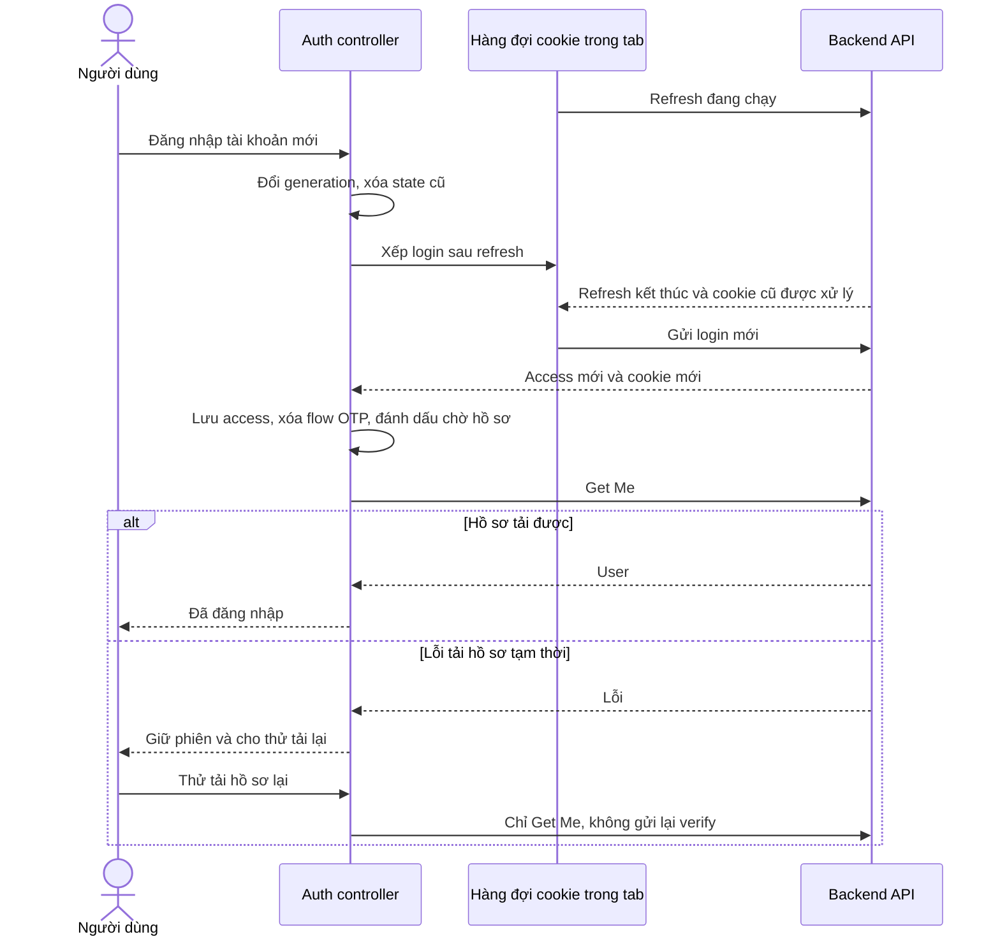
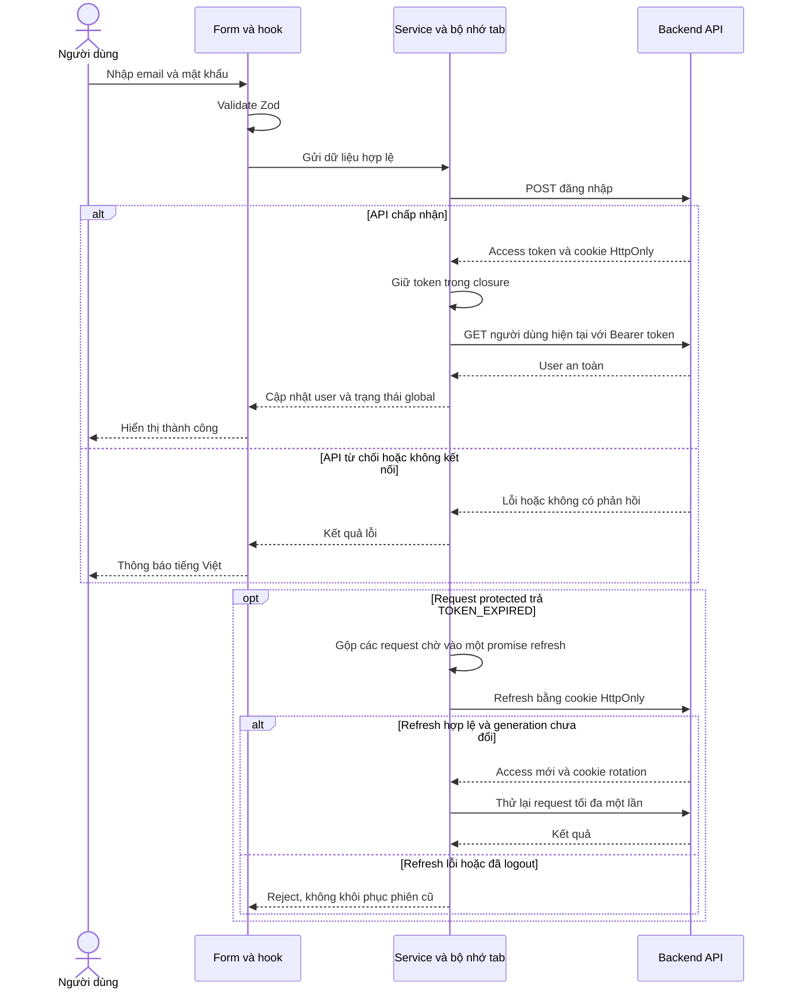

# Auth frontend

## Thiết kế đã duyệt và hiện trạng

Người dùng duyệt ngày 2026-11-25: API trực tiếp, access token ở bộ nhớ riêng ngoài Zustand, refresh cookie HttpOnly, store global, giao diện học tiếng Nhật đơn giản ít bo góc. Đã triển khai frontend. Backend auth/user hiện chỉ có thiết kế, chưa có endpoint thực. Không có tài khoản demo hoặc backend giả trong ứng dụng.

Đọc [Frontend README](../../../README.md) và [AGENTS frontend](../../../AGENTS.md).

Giao diện cập nhật theo yêu cầu hiện đại hơn và ít chữ mô tả: title trực tiếp, label/input/link chính 16px; bỏ caption, tagline và footnote thừa. Các bước auth, trường dữ liệu, validation, hook/store/service giữ nguyên. Không thêm dependency.

## File và trách nhiệm

### Sửa lỗi review được người dùng duyệt

Người dùng yêu cầu sửa hai lỗi: refresh cũ ghi đè cookie sau login mới và verify thành công bị mất phiên khi Get Me lỗi. Thiết kế dưới đây đã được triển khai; test controller trực tiếp dùng service giả, không mock React hook:

- `auth-session.ts`: hàng đợi thao tác cookie không bị xóa bởi clear; refresh vẫn single-flight theo generation. Login/verify/logout/reset confirm chờ thao tác cookie trước hoàn tất. Request đã gửi được chờ kết thúc; hủy UI chỉ hủy thao tác chưa gửi hoặc tải hồ sơ, không nhả hàng đợi sớm.
- Thêm `services/auth-controller.ts`: điều phối action độc lập React, nhận service/session/store. Hook use-auth chỉ đọc global store và gọi controller; không thêm hook hoặc dependency.
- `auth-client.ts`: wiring queue/controller dùng chung trong tab; không dùng singleton này phía server.
- `auth.store.ts`: thêm trạng thái `profile-pending` và action tương ứng, không thêm credential.
- Khi login/verify đã trả access token: lưu token bộ nhớ, xóa flow OTP đã dùng ngay, chuyển profile-pending. Get Me lỗi tạm thời không xóa token; UI cho retry Get Me hoặc logout, không gửi lại verify đã tiêu thụ.
- `auth-form.tsx`: dùng Button/FormMessage hiện có để hiển thị retry hồ sơ. Không thay payload API hoặc thêm component chung.
- Test bổ sung gọi controller thật với service giả: refresh/login/logout theo thứ tự, queue sau lỗi/hủy, verify thành công rồi Get Me lỗi/retry; không gọi API/email thật.



- `components/auth-form.tsx`: năm loại form, validation/loading/lỗi/thành công và thiếu/hết flow OTP. Route trong app chỉ cung cấp mode.
- `components/auth-provider.tsx`: khôi phục phiên một lần ở client bằng refresh và Get Me.
- `services/auth.service.ts`: tách login, register, verifyRegister, requestPasswordReset, confirmPasswordReset, logout, refresh, getMe; Zod kiểm tra payload/response, không import React/store.
- `services/auth-client.ts`: wiring browser, client public/protected và cập nhật global store; không dùng làm phiên server.
- `services/auth-controller.ts`: điều phối action và hàng đợi cookie, khôi phục phiên, tách chấp nhận credential khỏi tải hồ sơ; không phụ thuộc React hoặc singleton store.
- `services/auth-session.ts`: factory giữ access token, generation, promise refresh và verification flow trong closure; không storage/persist/log.
- `services/auth-errors.ts`: map mã lỗi sang tiếng Việt; không render raw message/stack API. 429 hiển thị Retry-After dạng giây nếu có, không tự gửi lại.
- `schemas/auth.schema.ts`: form/request/response Zod. Email trim, mật khẩu không trim; confirmPassword không gửi API.
- `types/auth.types.ts`: request/response auth; User import từ src/types/user.ts.
- `server/auth.ts`: server-only, getServerUser(accessToken, signal?) tạo client riêng từng lần và xác thực bằng GET /users/me; không chỉ decode JWT. Không tự đọc token bộ nhớ browser hoặc refresh từ server.

Store thuộc [src/stores](../../stores/README.md), component chung thuộc [components](../../components/README.md), HTTP infrastructure thuộc [lib](../../lib/README.md).

## Custom hook

| Hook | Interface | State, side effect và cleanup |
| --- | --- | --- |
| use-auth | user, status, action auth và retryProfile nhận input/signal | Đọc store và gọi controller; credential được chấp nhận chuyển profile-pending, chỉ authenticated sau Get Me |
| use-auth-request | run(action(signal)), pending, error | Chặn submit trùng, AbortController, cleanup khi unmount; không cập nhật UI đã unmount |
| use-verification-flow | purpose; trả valid/email/secondsLeft | Đọc flow bộ nhớ, kiểm tra purpose/thời hạn; timer 1 giây có cleanup, không trả token cho JSX |

## Contract frontend để ghép backend

Theo thiết kế [backend auth](../../../../backend/src/module/auth/README.md) và [backend user](../../../../backend/src/module/user/README.md). Backend chưa có DTO/OpenAPI triển khai; các schema sau là contract frontend dự kiến, phải đối chiếu lại khi backend có code.

| API | Body | Response kỳ vọng |
| --- | --- | --- |
| POST /auth/login | email, password | accessToken, tokenType Bearer, expiresIn giây |
| POST /auth/register | email, password | verificationToken, expiresIn giây |
| POST /auth/register/verify | verificationToken, otp | accessToken, tokenType Bearer, expiresIn giây |
| POST /auth/password-reset/request | email | verificationToken, expiresIn giây; giống nhau cho email có/không tồn tại |
| POST /auth/password-reset/confirm | verificationToken, otp, newPassword | HTTP 2xx, không phụ thuộc body |
| POST /auth/refresh | Không body, browser gửi cookie | accessToken, tokenType Bearer, expiresIn giây |
| POST /auth/logout | Không body, browser gửi cookie | HTTP 204 |
| GET /users/me | Authorization Bearer | id, email; displayName nullable/tùy chọn; strip field khác |

UI giới hạn mật khẩu mới 8–128 ký tự, email tối đa 254, OTP 6 chữ số giữ số 0 đầu. Đây là policy frontend đề xuất, chưa có policy DTO backend để xác nhận đồng nhất. expiresIn giây của response OTP là lựa chọn frontend cần backend xác nhận. OTP và mật khẩu mới được gửi cùng request reset confirm; không tự tạo endpoint kiểm tra OTP riêng.

Backend phải thực hiện hash/verify, SES, OTP/TTL/rate limit/chống replay, cấp/xóa cookie, CORS allowlist với credentials và kiểm tra Origin/CSRF theo deployment. Client dùng withCredentials ở login/verify/refresh/logout/reset confirm; không đoán endpoint/header CSRF. Trước production phải chốt cookie SameSite/Secure/Path và CSRF. Frontend không thay thế các cơ chế server chưa tồn tại.

## Luồng đăng nhập và refresh



Chỉ refresh protected request có 401/TOKEN_EXPIRED. Login sai, OTP sai không refresh. 401 đến muộn từ token cũ dùng token mới thay vì rotation lần hai. Hủy một request không hủy refresh dùng chung. Logout xóa state ngay, nhưng request logout chờ thao tác cookie trước kết thúc; generation ngăn response cũ khôi phục bộ nhớ. Login/verify/reset confirm cũng dùng cùng queue. Request credential đã gửi không bị AbortSignal UI cắt ngắn việc chờ response; signal chỉ hủy bước chưa gửi hoặc Get Me. Queue giữ nguyên qua clear và vẫn chạy thao tác tiếp theo nếu thao tác trước lỗi. Logout lỗi server hiển thị chưa xác nhận thu hồi. Lỗi mạng/5xx refresh không tự retry rotation.

API login/verify chấp nhận credential thì xóa flow OTP ngay và đánh dấu profile-pending. Get Me lỗi tạm thời giữ access token, UI dùng retryProfile để chỉ tải lại hồ sơ; không gửi lại OTP đã dùng. Nếu endpoint protected trả 401 INVALID_TOKEN/REFRESH_TOKEN_REUSED, interceptor vẫn xóa phiên như trước. Một response Get Me cũ không được ghi user sau khi generation đổi.

Giới hạn: single-flight trong một tab; chưa phối hợp nhiều tab/worker/thiết bị. Không bảo đảm concurrency phân tán. Không có server route guard do token bộ nhớ browser không tồn tại trong SSR. getServerUser chỉ dùng khi server caller đã có token qua transport được thống nhất.

## Đăng ký và khôi phục

```mermaid
sequenceDiagram
    actor U as Người dùng
    participant F as Frontend
    participant A as Backend Auth
    participant M as Email người dùng
    U->>F: Nhập email và dữ liệu đăng ký hoặc reset
    F->>F: Validate đầu vào
    F->>A: Gửi yêu cầu
    A->>M: Gửi OTP
    A-->>F: Verification token và thời hạn dự kiến
    F->>F: Giữ flow trong bộ nhớ, chuyển trang xác minh
    U->>F: Nhập OTP và mật khẩu mới nếu reset
    F->>A: Gửi token opaque kèm dữ liệu xác minh
    alt Xác minh thành công
        A-->>F: Cấp phiên đăng ký hoặc xác nhận reset
        F-->>U: Thành công; reset yêu cầu login lại
    else OTP sai, hết hạn hoặc token đã dùng
        A-->>F: Mã lỗi
        F-->>U: Nhập lại hoặc bắt đầu phiên mới
    end
```

Flow chỉ trong bộ nhớ: tải lại verify/reset yêu cầu bắt đầu lại. Không đưa email/OTP/token vào URL hoặc storage. Không giữ mật khẩu để tự gửi lại đăng ký; mã mới cần bắt đầu lại form. TTL client chỉ phục vụ UI; backend quyết định hiệu lực thật.

## Kiểm chứng

Chạy npm run typecheck, npm run lint, npm test, npm run build. Test Node dùng Axios adapter giả và controller thật với service giả, không HTTP/email thật. Bộ test hiện có 18 ca, trong đó 10 ca kiểm tra controller: thứ tự refresh/login/logout/reset, hủy UI/queue, queue sau lỗi, OTP sai, verify thành công rồi lỗi/retry hồ sơ, bootstrap lỗi hồ sơ và Get Me đến muộn. Cookie trong regression test được mô phỏng; cần kiểm thử với backend/browser thật khi endpoint sẵn sàng. Không xác nhận login, gửi email hoặc đổi mật khẩu thật khi backend chưa có endpoint.
