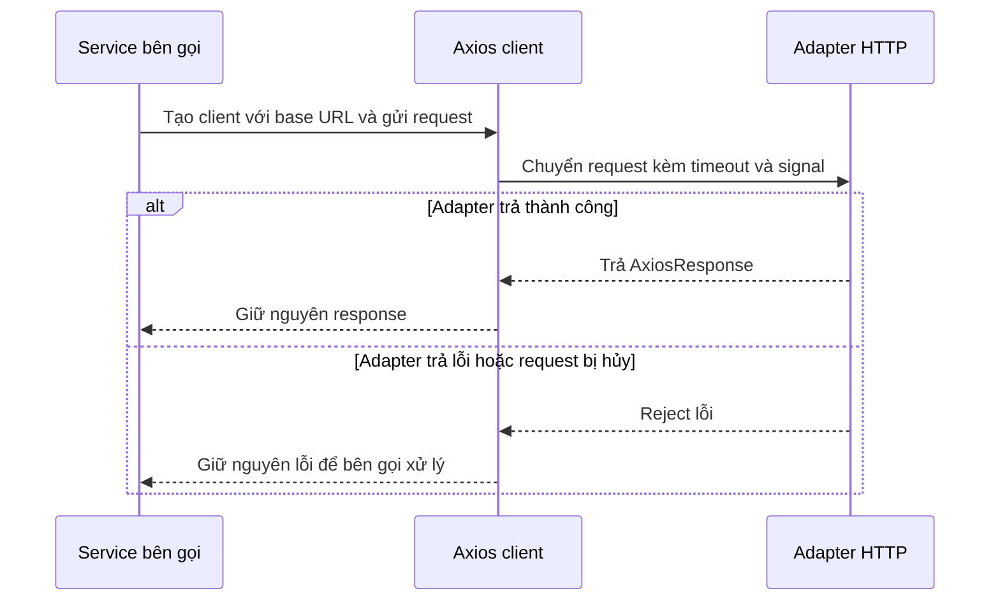

# Thư viện dùng chung

## Thiết kế và trạng thái

Task Axios ban đầu và phần mở rộng auth được người dùng duyệt ngày 2026-11-25. Đã triển khai client gốc và client protected với policy được inject; không import feature hoặc store. Chưa xác nhận kết nối backend thực.

## Mục đích và phạm vi

`axios.ts` export `createApiClient(baseURL: string): AxiosInstance`. Mỗi lần gọi trả một instance độc lập. Service nghiệp vụ tạo/tái sử dụng client phù hợp; module này không phụ thuộc React, feature hoặc môi trường Next.js.

Contract:

- Bên gọi cung cấp base URL đúng môi trường. Module không tự chọn endpoint, đọc env hay gửi request khi import/khởi tạo.
- Timeout mặc định 15.000 ms; header `Accept: application/json`.
- API `get/post/put/patch/delete` và cấu hình từng request giữ nguyên của Axios.
- Response trả nguyên `AxiosResponse<T>`; lỗi reject nguyên lỗi Axios, không bọc hay nuốt lỗi.
- Hủy request bằng `signal` từ `AbortController`.
- Client gốc không tự gắn token/cookie hoặc retry. Không thêm `Content-Type` chung để Axios xử lý đúng JSON hoặc FormData.
- `createAuthenticatedClient(baseURL, authPolicy)` thêm Bearer từ callback, generation và interceptor 401/TOKEN_EXPIRED. Policy gồm getToken, getGeneration, refresh, onExpired; nghiệp vụ cung cấp policy từ phía browser.
- Request protected chỉ retry một lần sau refresh. Token đã được thay bởi request khác thì không refresh lần hai. INVALID_TOKEN/REFRESH_TOKEN_REUSED và TOKEN_EXPIRED sau retry làm hết phiên qua callback; lỗi login/OTP thuộc client gốc không bị refresh.
- Single-flight do policy auth quản lý trong một tab, không phải singleton refresh chung phía server. Hủy request không hủy promise refresh chung; lỗi mạng/5xx refresh không tự retry rotation. Chi tiết tại [auth README](../features/auth/README.md).



## Cách dùng

```ts
import { createApiClient } from './axios';

const client = createApiClient('https://api.example.com');
const controller = new AbortController();
// Đường dẫn dưới đây chỉ minh họa, không phải contract backend của dự án.
const response = await client.get<{ label: string }>('/example', {
  signal: controller.signal,
});
console.log(response.data.label);
```

Service/hook bên gọi sở hữu vòng đời `AbortController`, gọi `abort()` khi cần. Không đặt dữ liệu xác thực từng người dùng trong instance chia sẻ phía server.

## Dependency và kiểm chứng

Runtime: `axios@1.21.1`; phát triển: `typescript@5.9.3`; khai báo tại [package.json](../../package.json). Axios có sẵn type; không thêm `@types/axios`. Rủi ro dependency bên thứ ba được giới hạn bằng phiên bản chính xác và lockfile.

Chạy `npm run typecheck` tại `frontend/`. Kiểm tra bổ sung bằng adapter giả trong bộ nhớ: cấu hình mặc định, instance độc lập, response, lỗi và hủy request; không gửi HTTP thật. Kiểm tra này không xác nhận kết nối backend hoặc giao diện.

Task Axios ban đầu đã pass kiểm tra qua stdin. Test mở rộng được lưu tại [auth.test.mjs](../../test/auth.test.mjs), chạy bằng npm test trên Node 24: single-flight, response đến muộn, retry giới hạn, invalidation logout, cancellation và contract API. Không gửi HTTP/email thật.
